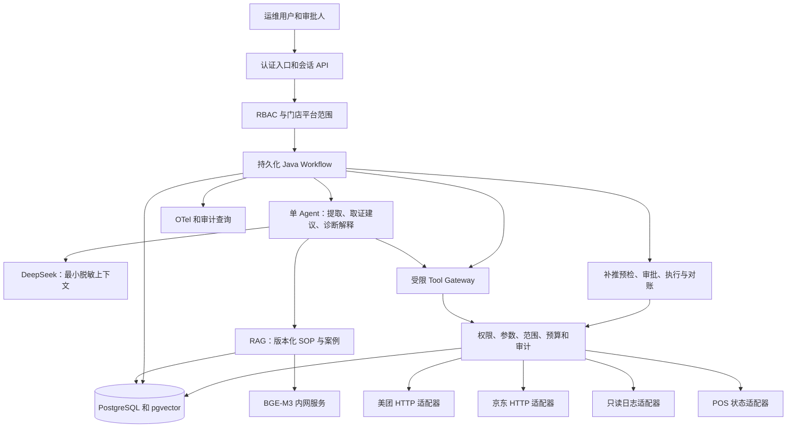
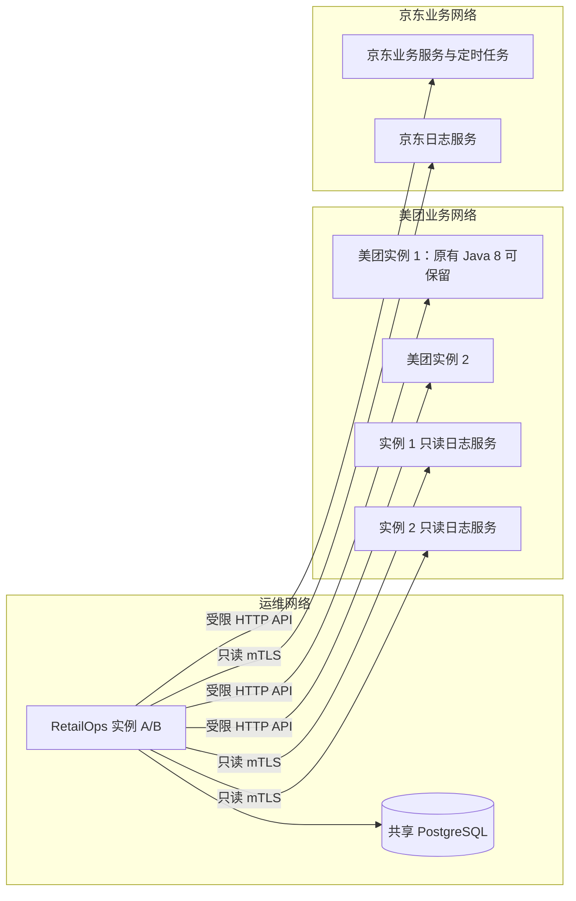

# 04 总体架构与模块拆分

## 技术基线

拟采用 Java 17、Spring Boot 4.1.1、Spring AI BOM 2.0.2、DeepSeek、PostgreSQL + pgvector、BGE-M3 独立推理服务、Micrometer/OTel。具体依赖校验见 ADR。先做模块化单体，模块是包边界而非每个独立进程；未来按隔离或吞吐需求拆分。

AG 只能获得当前节点允许的只读工具定义。REPLAY 由后端命令触发，不把生产执行工具直接放入聊天模型的自动调用列表。

## 多服务器部署

服务目录由管理员维护 systemId、environment、instanceId、有效起止时间与能力引用。查询根据订单时间覆盖当时实例，包括已下线实例的归档日志。实例不可达单独报告；不允许模型提供 IP、URL 或文件路径。原业务调用 POS 的逻辑保留在原系统。

## 模块契约

| 包/模块（拟建） | 职责和主要类 | 输入输出 | 依赖和独立开发性 |
|---|---|---|---|
| api / identity | DiagnosisController、ReplayController、AccessPolicy | 身份与请求 → 授权上下文 | Mock 身份可独立；生产对接 SSO |
| domain | OrderKey、Evidence、PosStatusSnapshot、Capability | 业务无关契约 | 独立，禁止引用 Spring AI 类型 |
| agent | IntentExtractor、PlanProposer、EvidenceAnalyst、ReportComposer | 文本/证据 → 结构化结果 | 依赖 domain 和 ModelGateway，可 Mock |
| workflow | WorkflowRunner、NodeExecutor、RunRepository | 诊断请求 → 可恢复任务 | 依赖契约与数据库，可独立 |
| tools | ToolRegistry、ToolGateway、ToolPolicy | 类型化参数 → ToolResult | 依赖身份、审计；无真实业务可 Mock |
| integration.meituan/jd/pos | 各 OrderAdapter 与 StatusMapper | 内部契约 ↔ 现有 HTTP | 实际实现必须等待源码/协议 |
| integration.logs | ServiceCatalog、LogCoverage、LogSearchAdapter | 逻辑查询 → 日志证据 | 框架可独立，解析器依赖样例 |
| knowledge | DocumentIngestor、KnowledgeRetriever、CitationValidator | 文档 → 有引用片段 | Mock 文档独立；真实规则需审核 |
| replay | ReplayPreviewService、ApprovalService、ReplayExecutor、Reconciler | 预检 → 审批 → 执行状态 | 框架独立，启用依赖旧系统幂等证明 |
| audit / evaluation | AuditWriter、TraceContext、EvaluationRunner | 事件 → 审计/指标 | 从基础阶段即接入 |

依赖方向：API → 应用服务 → domain/ports；适配器实现 ports。知识模块不直接调用补推；Agent 不直接访问数据库；所有调用通过 Gateway。禁止从诊断 Tool 递归进入同一 Workflow。

## 非功能预算（初始验收目标）

测试环境先验证 10 个并发诊断、每任务最多 12 次工具调用和 3 次 LLM 调用、90 秒总时限。单次只读 HTTP 默认 5 秒，允许至多 2 次有抖动重试，但不得超过任务预算；模型调用独立预算 30 秒。实际平台约束优先，数值均可配置。

诊断 API 返回 taskId，前端轮询任务事件；SSE 为后续体验优化。任务状态必须跨重启恢复，副作用执行不能自动重放。数据库故障时停止新补推。可用性和灾备目标在获知部署资源后锁定，当前不声称达到生产 SLA。
