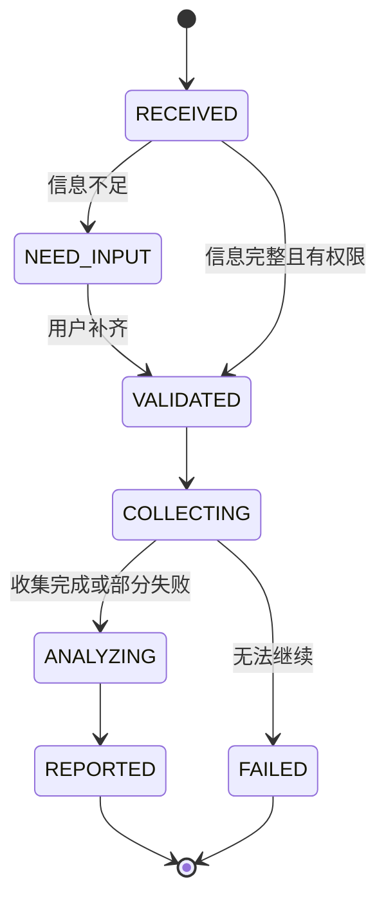
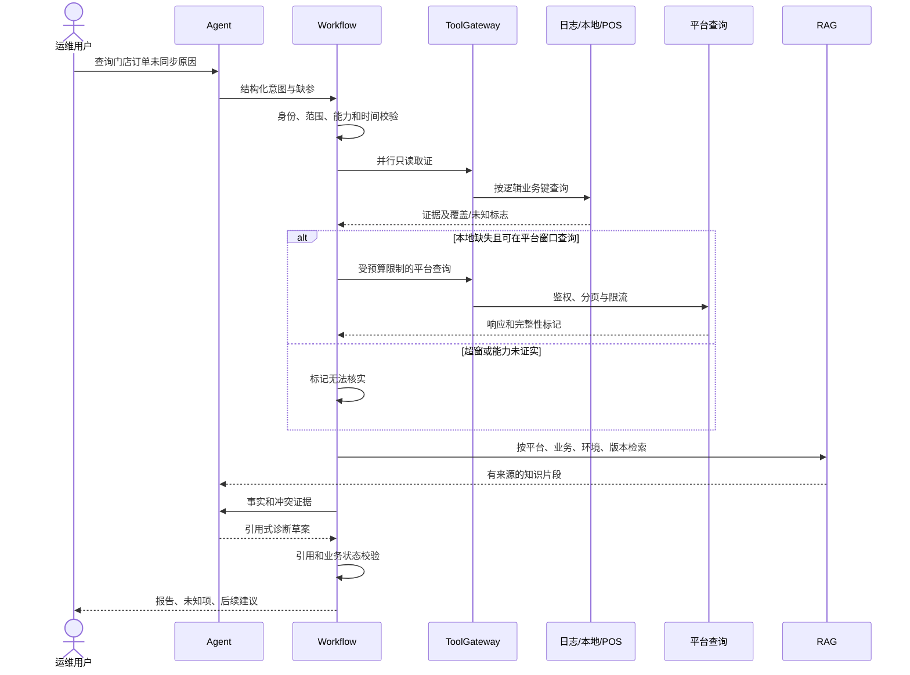
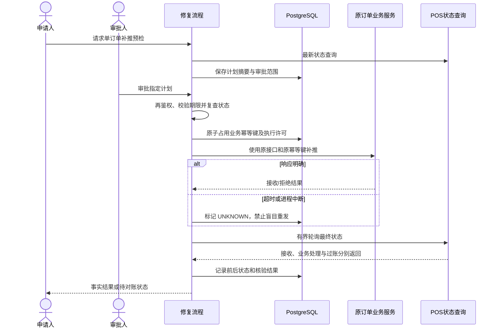

# 06 工作流与受控自愈

## 只读诊断状态机

每个节点提交输入摘要、输出引用、状态版本、尝试次数和 deadline；用乐观锁防止重复推进。只读节点可在租约到期后恢复。取消任务停止后续查询，已经发出的远程请求可能仍完成，审计须保留其结果。PARTIAL 为报告质量而非伪装成功。

MVP 尚无 RAG 时跳过 K，使用经确认规则。超过美团查询窗口时不发无效搜索；窗口边界由适配器按平台定义判定，不擅自解释为固定 120 小时。分页达到上限后标记不完整，空响应只有完整检索和有效权限前提下才支持“本次查询未找到”。

## 补推状态机（后续阶段）

PREVIEWED → AWAITING_APPROVAL → APPROVED → REVALIDATING → DISPATCHING → VERIFYING → VERIFIED / ACCEPTED_PENDING_POSTING / FAILED / UNKNOWN。

预检绑定业务键、当前状态/版本、请求摘要、策略版本、环境、申请人和过期时间。审批由有范围权限的独立审批人执行；参数变化、状态变化、权限撤销、审批过期都使计划失效。执行前重新查询 POS 和原系统状态，不能复用陈旧预检结论。

## 崩溃与并发边界

本地数据库事务无法覆盖远程 POS。先持久化执行意图，再调用远程接口；发送后宕机或落库失败均视为结果未知。恢复进程先核验，不自动重新发送。只有下游有已验证幂等保障时，才允许在同一个 operationId 下安全重试。

幂等键以租户/环境/平台/业务/门店/业务单号/修复动作及必要业务版本构成，不包含每次随机请求 ID。退货与税率补充的业务标识等待源码确认。数据库唯一约束和状态 CAS 控制并发；释放租约不证明远程操作已结束。全链路不宣称 exactly-once。

无法确定下游幂等性或无法可靠核验时关闭自动补推，保留人工处置建议。失败补偿默认为对账、任务挂起和升级处理，不自动删 POS 单、回滚财务业务或整批重跑。

税率补充增加 TASK_TRIGGER → FETCH_PAGE → PARSE → LOCAL_PROCESS → POS_SEND 节点，按批次和单单保存结果；未知游标语义时不做批量修复。预览必须列出影响范围，MVP 自愈只支持单订单。
