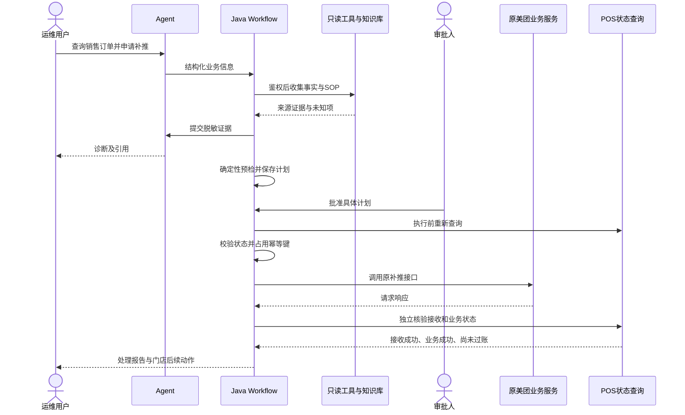

# RetailOps Agent：建成后的能力、美团销售订单示例与简历写法

编写日期：2026-11-09。

本文回答三个问题：项目按现有设计实现后能做什么；一笔美团销售订单出现同步异常时如何处理；完成后如何把实际成果写进简历。

**本文描述的是建成后的目标效果，当前项目仍处于设计阶段。下文订单、时间、日志证据、知识条目和处理结果均为演示用假设，不是真实业务调用记录。** 正式接入时需要依据现有源码和接口协议确认能力，尤其是补推幂等、POS 状态查询以及美团接口时间范围。

## 一、项目建成后是什么

RetailOps Agent 是一个面向零售订单异常的统一运维入口。运维人员输入“某门店某笔订单为什么没有同步”，平台能够定位业务系统，收集日志、订单状态和平台/POS 响应，给出有证据的诊断；对具备修复条件的订单，生成补推计划，在授权审批后复用原有接口执行，并核验结果。

它的业务目标是减少人工跨服务器查日志、跨系统核对状态和反复确认补推结果的工作，让一次订单异常从发现、诊断、处理到核验都有记录。

原有美团、京东项目继续负责订单接收、业务转换和推送 POS。RetailOps 负责统一诊断与受控调度，优先复用这些项目的能力，不重新实现一套订单同步业务。

### 1. 用户实际能得到什么

| 用户需求 | 完整实现后的能力 | 用户得到的结果 |
|---|---|---|
| “帮我查这笔单” | 自然语言识别平台、业务、订单号、门店和时间；缺信息时追问 | 一次有明确业务范围的诊断任务 |
| “不知道该去哪台机器查” | 根据服务目录定位项目、实例及对应时间的日志 | 已查询实例、未覆盖实例和关联日志证据 |
| “到底卡在哪里” | 对照回调接收、本地处理、平台订单和 POS 状态进行诊断 | 已证实事实、候选原因、冲突和待核实项 |
| “这个错误应该怎么处理” | 检索错误码说明、接口文档、SOP 和已审核历史案例 | 带文档版本及来源引用的解释和建议 |
| “这笔单能不能补推” | 检查权限、订单状态、接口能力、幂等和核验条件 | 可执行计划或明确的阻断原因 |
| “批准后帮我补推” | 执行前复查，通过原业务接口进行单订单补推 | 请求结果、业务核验结果和完整审计 |
| “补推成功了吗” | 区分接口响应、POS 接收、POS 业务处理、门店过账 | 不混淆业务阶段的结果说明 |
| “上次谁处理过” | 查询历史任务、审批、执行与最终状态 | 可追溯的处理记录 |
| “怎样知道 AI 是否可靠” | 使用固定故障集评估路由、工具选择、诊断与引用质量 | 可复现的评估报告和失败案例 |

### 2. 五类业务的最终覆盖范围

| 场景 | 重点诊断内容 | 接入顺序 |
|---|---|---|
| 美团销售订单 | 回调接收、本地处理、平台搜索、POS 推送与状态核验 | 首个 MVP |
| 美团退货订单 | 退货接收、原单关联、退货处理和 POS 退货单 | 销售链路稳定后 |
| 京东销售订单 | 京东回调、独立状态码和补推协议 | 独立京东适配器 |
| 京东退货订单 | 退货业务身份、原单关系、退货状态和重复事件 | 京东销售之后 |
| 京东税率补充订单 | 定时任务、拉取窗口、分页游标、转换及逐单推送 | 最后接入独立工作流 |

“支持五个场景”意味着五个场景都完成真实规则映射和测试，不是注册五个工具名称。某场景没有安全补推接口时，仍可以支持诊断，但必须明确该场景不支持自动补推。

### 3. 不同交付阶段的能力不同

| 交付版本 | 可以演示的能力 | 简历可以描述到什么程度 |
|---|---|---|
| 美团销售只读 MVP | 意图识别、缺参追问、日志/订单/POS 查询、证据报告 | 美团销售订单智能诊断；不能写已实现自愈 |
| MVP + RAG | 在事实证据上增加 SOP、错误码和历史案例引用 | 实时工具与知识检索结合的故障诊断 |
| 增加受控补推 | 预检、审批、幂等、执行、核验和未知结果对账 | 美团销售订单诊断与受控自愈闭环 |
| 完整平台 | 五场景适配、恢复机制、安全评测与可观测性 | 全渠道订单智能运维平台，按实际接入范围写 |

## 二、以美团销售订单未同步为例

### 1. 原有业务流程

订单未在 POS 中出现，可能发生在任一环节。RetailOps 需要把证据串起来，而不是看到“未同步”就立即重发。

### 2. 本例的演示前提

本例发生在隔离测试环境，演示时点为 2026-11-09 10:00，时间均为 Asia/Shanghai。虚构订单号为 `MT-DEMO-20261109-0001`，门店为 `DEMO-10001`。

假设业务调研与联调已经确认：

- 美团同步项目有两个服务实例，均可通过受限日志接口查询，且本例时间段日志覆盖完整。
- 原系统有可靠的本地处理状态查询和销售订单补推接口，补推请求能够关联同一业务身份。
- 原系统及下游的幂等约束经过验证，POS 查询可确认单据状态及对应的业务键。
- 查询一致性和延迟边界已明确，执行前能够判断是否有进行中的推送或结果未知的历史请求。
- 本例故障是一次数据库连接异常；业务处理停留在推送之前，之后数据库已恢复。
- POS 业务处理完成后仍需要门店过账，测试查询接口能够分别提供这些状态。

这些前提不代表当前公司系统已经具备相应接口；其中任一关键能力缺失，都应降低自动处理范围。

### 3. 第一步：用户用自然语言发起诊断

用户输入：

> 帮我查一下 DEMO-10001 门店的美团销售订单 MT-DEMO-20261109-0001 为什么没有同步到 POS，如果可以的话帮我补推。

Agent 识别出：

| 信息 | 识别结果 | 如何使用 |
|---|---|---|
| 平台 | 美团 | 选择美团适配器 |
| 业务类型 | 销售订单 | 选择销售诊断工作流 |
| 门店 | DEMO-10001 | 与用户授权范围求交集 |
| 订单号 | MT-DEMO-20261109-0001 | 作为字符串精确定位 |
| 用户意图 | 诊断，并在允许时申请补推 | 进入诊断与预检，不直接执行生产操作 |
| 订单时间 | 未提供 | 通过可靠本地查询补充，必要时追问 |

环境和用户权限来自已认证会话，不能让模型自行指定。即使订单号看起来包含日期，也不把它当作订单时间。

若本地无法补齐时间，系统追问：

> 这笔订单大约是什么时间产生的？需要用它确定日志范围，并判断是否能通过美团订单查询接口核实。

用户补充：“今天 09:30 左右。”系统据演示时点解释为 2026-11-09，再用本地实际记录核验。本例查询得到的订单时间为 09:30:12。

### 4. 第二步：查询日志、本地状态和 POS

Workflow 校验用户对该测试门店的访问权限，再由工具网关调用只读工具。以下证据编号仅用于本例演示：

| 证据 | 查询结果 | 能说明什么 |
|---|---|---|
| E1：实例覆盖报告 | 两个预期实例均已查询，相关时段无轮转缺口 | 本次日志覆盖较完整；不是对所有历史日志的保证 |
| E2：回调接收日志 | 实例 2 在 09:30:15 接收到该销售订单 | 本地确实接收过订单，不能归因为美团未回调 |
| E3：业务异常日志 | 09:30:16 出现数据库连接异常，关联同一处理链路 | 数据库异常是候选阻断原因 |
| E4：本地状态查询 | 处理记录停留在已验证的推送前失败阶段，无进行中或未知的推送任务 | 结合源码确认的状态语义，支持“本地未完成处理” |
| E5：POS 状态查询 | 在已确认的一致性条件下未查到对应销售单 | 当前未发现 POS 单据，不能仅凭这条证据保证任何并发请求都不存在 |

在本例中，E3 与 E4 共同支持本地数据库异常导致流程中断。只看到一条异常日志不足以判断整笔订单失败，因为原系统可能已重试成功；因此仍需要查当前状态与 POS。

系统不会把全服务器日志交给模型，也不会让模型执行 SQL、Shell 或 SSH。工具只返回授权范围内的脱敏证据，并保留来源和时间。

### 5. 第三步：按需要核实美团平台订单

本例中的工作流需要在补推预检前核实平台订单当前状态，且已确认该订单处于允许查询的窗口内，因此调用美团订单查询适配器。

假设查询得到 E6：平台存在该订单，门店匹配，订单当前状态经已核验的业务规则判断允许继续本地处理。具体状态码和补推资格必须来自真实协议与业务代码，本例不虚构平台字段。

查询工具负责鉴权、分页、限流和超时。若查询没有完整结束，返回“查询不完整”，不把部分空结果解释为订单不存在。任务书中的“最近 5 天”按实际接口语义实施，不在这里假定窗口精确等于 120 小时。

不是每次诊断都必须查询平台：若本地和 POS 已能证明订单成功，则直接报告结果即可，避免无意义调用。

### 6. 第四步：结合知识库解释原因

系统检索已审核的美团销售排查 SOP，得到本例假设的 `SOP-MT-SALE-DB@v1#恢复检查`。该知识说明：数据库恢复后，仍需检查本地处理状态、POS 当前状态和幂等条件，再通过既有补推流程处理。

两类信息的分工是：

- **实时工具证据**回答“这笔订单实际发生了什么”。
- **RAG 知识**回答“这种已确认的故障通常怎样检查和处置”。

知识库不会因为记载“数据库恢复后可重试”，就自动认定这笔订单具备补推资格。可执行性仍由 Java 预检根据当前状态判断。

系统向用户返回的诊断示例：

> 已确认本地服务接收过该订单。处理期间出现数据库连接异常，本地记录停留在推送前失败阶段；当前 POS 查询未发现对应销售单。综合判断，本次同步中断与本地数据库异常有关。
>
> 依据：回调接收 E2、数据库异常 E3、本地处理状态 E4、POS 查询 E5。平台查询 E6 确认订单存在。
>
> 可以继续进行补推预检查。相关处理依据为 SOP-MT-SALE-DB@v1 的恢复检查条目。

### 7. 第五步：生成具体的补推预检结果

预检服务重新核对依赖健康及订单状态，并生成一份可审核计划：

| 项目 | 本例预检结果 |
|---|---|
| 目标 | 测试环境 / 美团销售 / DEMO-10001 / 指定单笔订单 |
| 修复动作 | 调用原美团同步服务已验证的销售订单补推接口 |
| 数据来源 | 原业务系统能够可靠读取的订单数据，不直接拼装平台回调 |
| 依赖状态 | 数据库恢复检查通过 |
| 订单资格 | 本地、平台状态满足已核验的销售业务规则 |
| POS 和并发检查 | 未发现已成功单据，未发现进行中或未知的同业务推送 |
| 幂等条件 | 原系统/下游幂等能力已验证；本次操作绑定同一业务键 |
| 审批 | 本演示沿用生产级流程，由独立审批人批准 |
| 有效性 | 绑定参数摘要、状态版本和有效期；变化后重新预检 |
| 执行后核验 | 查询本地与 POS 状态，分别确认接收、处理及过账 |

预检并不发送订单。用户说“可以的话帮我补推”是申请意图，实际写操作仍由后端授权策略与审批流程控制。

### 8. 第六步：审批后复查并执行

审批人查看订单、环境、证据、影响范围和计划，批准该具体操作。执行服务随后：

1. 再次检查申请人、审批人、计划有效期和业务范围。
2. 重新查询本地与 POS；若订单已被其他途径处理成功，取消本次发送并报告最新状态。
3. 原子记录执行意图和审批消费，占用业务幂等键，防止 RetailOps 内部并发重复执行。
4. 复用原美团同步服务的补推接口，由原系统执行转换、校验和 POS 推送。
5. 记录响应，进入结果核验。

原系统中的定时重试或人工操作也可能并发发送，因此平台内部锁并不足够，必须依赖经过验证的下游业务幂等能力。审批完成后若发现状态变化，也不能沿用旧结论强行发送。

### 9. 第七步：核验最终业务结果

本例假设补推后查询确认 POS 已生成销售单，但门店尚未过账。系统按四个维度返回：

| 维度 | 本例结果 | 依据 |
|---|---|---|
| 补推接口调用 | 成功返回 | 本次请求响应 |
| POS 接收 | 已确认接收 | POS 查询/回执 |
| POS 业务处理 | 已生成销售单 | POS 业务状态查询 |
| 门店过账 | 尚未完成 | POS 过账状态查询 |

最终报告示例：

> **处理结果：补推后已核验 POS 销售单生成，门店尚未过账。**
>
> 订单：MT-DEMO-20261109-0001；门店：DEMO-10001；环境：测试。
>
> 原因：本地处理期间发生数据库连接异常，流程在推送前中断。数据库恢复后，系统完成预检，经审批调用原美团业务服务补推，并重新查询确认 POS 已接收且销售单已生成。
>
> **订单已经成功推送到 POS，但仍需要门店自行完成过账操作。**
>
> 本任务保留诊断证据、SOP 引用、审批记录、补推响应和核验结果，可按任务编号查看。

### 10. 如果实际结果不同，平台怎么处理

| 实际情况 | 平台应有行为 |
|---|---|
| POS 已有成功销售单，只差门店过账 | 告知门店后续动作，不重复补推 |
| 本地无记录，平台有订单 | 报告“平台存在，本地接收未证实”；检查日志覆盖和回调链路，不能默认具备补推数据 |
| 某服务实例日志不可达 | 标记证据覆盖不足，不能断言本地完全没有收到订单 |
| 超出美团允许查询窗口 | 说明无法通过该接口核实，继续使用其他合法证据或转人工 |
| 数据库故障仍未恢复 | 阻断补推，提供处理建议 |
| 接口 HTTP 200，但 POS 返回业务错误 | 记录业务失败，不报告补推成功 |
| 补推请求超时 | 进入 UNKNOWN，先查询核验，不立即重发 |
| 超时后查到 POS 单据已生成 | 更新为核验成功，不再补推 |
| 超时后仍无法确定是否写入 | 保持待对账并升级人工，不能以查询暂空为由盲目重发 |
| 原系统不支持幂等或缺少可靠核验接口 | 禁用自动补推，保留只读诊断和人工处置建议 |
| 审批过期、参数变更或权限被撤销 | 拒绝执行，重新预检和授权 |

## 三、这个例子体现了哪些 AI Agent 工程能力

| 能力 | 在美团销售示例中的体现 | 主要负责方 |
|---|---|---|
| 自然语言理解 | 提取平台、订单与操作意图，发现订单时间缺失 | LLM + Schema 校验 |
| 受限规划 | 根据证据决定是否补查平台或特定日志上下文 | Agent 提议，Workflow 控制 |
| Tool Calling | 通过明确参数调用日志、订单、平台和 POS 查询 | Spring AI 接入 + ToolGateway |
| 证据分析 | 关联回调、数据库异常、当前订单与 POS 状态 | LLM 分析 + 确定性事实校验 |
| RAG | 引用适用版本的故障 SOP | 检索服务 + 引用校验 |
| 人机协同 | 用户补参、审批人批准具体计划 | 会话与审批服务 |
| 受控执行 | 权限、幂等、限流、状态复查及调用既有补推接口 | Java 服务 |
| 故障恢复 | 超时后进入未知状态，恢复时先对账 | 持久化 Workflow |
| 可观测性 | 从用户问题关联到每次工具调用和最终业务结果 | Trace + 审计 |
| 效果评估 | 验证正确诊断、合理拒答、工具选择和引用质量 | 固定测试集 + 人工复核 |

模型最有价值的部分是处理自然语言和异构证据，使系统能解释问题、选择必要的取证路径。补推安全性来自确定性的服务端控制，两者共同构成项目的工程深度。

MCP 和 Multi-Agent 不是本方案默认交付项。只有后续实际实现并证明有价值时，才将它们列为项目能力。

## 四、实现后简历可以怎么写

### 1. 填写原则与项目身份

项目名称建议：**RetailOps Agent——全渠道订单智能运维与受控自愈平台**。只完成美团只读 MVP 时，名称改为“RetailOps Agent——美团销售订单智能诊断平台”更准确。

项目时间填写实际开发起止时间；职责填写你真正负责的部分。个人完成可写“独立负责架构设计、核心开发与测试”，不能因此自称公司项目负责人。多人参与则明确自己负责的模块。

环境说明按实际选择：

- 个人项目：“基于真实零售业务问题设计，使用脱敏样例与 Mock 环境验证。”
- 测试联调项目：“完成企业测试环境中美团/京东/POS 接口联调。”只有实际完成的系统才列出。
- 企业上线项目：“已在企业内部试点/上线。”随后写明真实范围及可证明的效果。

### 2. 完整平台实现后的简历示例

以下为完成对应能力后可使用的文案；五场景、RAG、补推、观测和评估未完成的条目应删除或收窄。

**项目名称：RetailOps Agent——全渠道订单智能运维与受控自愈平台**

**技术栈：** Java 17、Spring Boot 4、Spring AI 2、DeepSeek、PostgreSQL、pgvector、BGE-M3、Spring Security、OpenTelemetry、Docker。

**项目背景：** 针对零售企业美团、京东订单同步服务分散部署、故障定位依赖人工查日志、补推过程缺少统一核验的问题，建设自然语言驱动的订单运维平台，覆盖销售、退货及税率补充等五类业务流程。

**核心工作：**

- 设计单 Agent 与持久化 Java Workflow 协作架构，实现意图识别、缺参澄清、受限取证与诊断报告生成，将权限、审批和业务执行纳入确定性流程控制。
- 建设统一 ToolGateway 与美团、京东、POS、日志适配器，通过类型化契约连接分散业务系统，支持跨实例证据关联、查询覆盖记录、超时限流与调用审计。
- 基于 BGE-M3 与 pgvector 构建运维知识检索链路，结合实时订单证据与版本化 SOP，按平台、业务和权限过滤知识，输出可追溯的诊断引用。
- 实现“预检—审批—复查—补推—核验”闭环，复用原系统推送接口，通过业务幂等键、状态并发控制和未知结果对账降低重复写入风险，分离 POS 接收、业务处理与门店过账状态。
- 建立故障评估集和端到端追踪，验证意图路由、工具选择、诊断质量、引用正确性及越权/重复补推等异常场景，并通过消融实验衡量 Agent 与 RAG 的实际收益。

这段文案不依赖虚构的提升比例。获得实际数据后，可用下文指标替换一条较泛的描述，使项目更有说服力。

### 3. 只有美团销售只读 MVP 时的简历示例

**项目名称：RetailOps Agent——美团销售订单智能诊断平台**

**项目简介：** 面向美团销售订单未同步到 POS 的排查场景，开发基于 Spring AI 与 DeepSeek 的诊断应用，通过自然语言交互整合分散的订单状态和日志证据。

**核心工作：**

- 实现平台、业务类型、订单号、门店与时间的结构化提取及缺参追问，通过 Java Workflow 控制诊断节点与工具预算。
- 封装日志、本地订单、平台订单及 POS 状态查询工具，提供参数校验、门店范围控制和证据来源记录，支持缺失日志、接口超时及查询窗口外等异常处理。
- 实现证据式诊断报告，区分接口响应、POS 接收、业务处理与门店过账，避免将日志未命中或单次请求成功直接当作业务结论。
- 基于脱敏故障集开展工具选择、诊断及权限校验测试，记录测试环境与样本范围。

若此时已经完成 RAG，可增加一条知识检索与引用说明；若尚未实现补推，不写“已实现自动修复”“已完成自愈闭环”。

### 4. 聚焦美团销售闭环的精简写法

适合已实现美团销售诊断、RAG 和受控补推，但尚未完成另外四个场景时使用：

> 针对美团销售订单未同步到 POS 的问题，设计并实现基于 Spring AI、DeepSeek 与 Java Workflow 的运维 Agent，联动跨实例日志、本地订单、平台订单和 POS 状态进行证据诊断；结合版本化 SOP 检索生成带引用的处理建议，复用原业务接口完成预检、审批、幂等补推和结果核验，并针对请求超时建立 UNKNOWN 状态及对账恢复流程。

如果接口均为 Mock，在项目背景中补充“在 Mock 环境完成闭环验证”；不能把适配器可扩展性写成已经完成五类真实业务接入。

### 5. 如何加入真实量化成果

下列表述是填写模板，方括号必须由实际结果替换；不要直接把设计验收目标写成实测成绩。

| 指标 | 可以写的句式 | 需要保留的依据 |
|---|---|---|
| 故障覆盖 | “构建覆盖 [N] 类故障、[M] 条样例的脱敏评估集。” | 数据集版本、场景分布、去重规则 |
| 诊断质量 | “在冻结测试集上，根因分类 Macro-F1 达到 [X]。” | 标签、预测、分母、各类别结果和模型版本 |
| 排查耗时 | “在相同故障集上，诊断耗时中位数由 [A] 降至 [B]。” | 人工基线、相同计时边界与配对样例 |
| RAG 效果 | “加入知识检索后，[明确指标] 从 [A] 提升至 [B]。” | 同一测试集的有/无 RAG 对照 |
| 安全性 | “在 [N] 个并发及故障注入用例中，未出现重复业务创建。” | 测试日志、下游幂等前提、核验结果 |
| 性能 | “在 [硬件/环境]、[并发量] 下，诊断 p95 为 [T]。” | 工具/模型响应条件、压测配置和报告 |
| 生产收益 | “试点覆盖 [范围]，统计周期 [周期] 内人工介入次数减少 [比例]。” | 真实上线记录、工单数据与口径 |

耗时降低比例可按 `(基线耗时 - 新耗时) / 基线耗时 × 100%` 计算；使用相同统计量，例如都比较中位数。必须把诊断耗时与等待人工审批的总处理耗时分开，不能把 Mock 毫秒级接口耗时当作生产效果。

### 6. 针对不同岗位突出什么

**投递 Java + AI 应用岗位：** 保留 Agent 与 RAG，同时突出旧系统解耦、适配器、权限、事务边界、并发幂等、状态恢复和工程测试。

**投递 AI Agent 应用岗位：** 突出意图与槽位提取、工具 Schema、受限规划、上下文管理、实时证据与 RAG 结合、评估及错误恢复，并说明如何证明模型带来的增益。

技术栈写实际用过且能解释的组件。不因为招聘描述出现 LangGraph、MCP、多 Agent、Redis 或模型微调，就把未使用的技术补进项目。

## 五、面试时如何用这个案例讲清楚项目

### 1. 一分钟项目介绍（完成闭环后使用）

> 我做的是零售订单异常诊断和受控补推平台。原来的美团、京东同步服务分散在不同项目和服务器，订单没到 POS 时，通常需要人工查日志、核对本地和平台状态，再调用补推接口。
>
> 我用 Spring AI 接入 DeepSeek，让模型理解问题并分析取证结果，通过统一工具层连接日志、订单和 POS 查询。流程执行由持久化 Java Workflow 控制，模型不负责授权和直接生产写入。知识库提供有版本引用的 SOP。
>
> 以美团销售为例，系统会确认订单是否被接收、卡在哪个环节，满足条件时生成补推计划，经审批和状态复查后复用原接口执行。如果请求超时，先对账而不是立即重发，最终分别报告 POS 接收、业务处理和门店过账状态。

### 2. 最值得深入讲的三个问题

**为什么要同时有 Agent 和 Workflow？** 自然语言表达和故障证据组合变化较大，适合由模型理解、补充取证和解释；权限、重试、审批与状态转换必须稳定可测试，因此由 Java 控制。可以用模型提议不允许工具但被网关拒绝的测试证明边界。

**怎样避免补推重复？** 先确认业务身份，执行前复查，平台内部使用唯一约束和状态竞争控制；平台外部还要依赖原系统/下游已验证的幂等能力。请求已发出但响应丢失时进入未知状态，通过查询恢复，不能宣称仅靠分布式锁就实现全链路 exactly-once。

**怎样证明 RAG 有用？** 实时证据告诉系统发生了什么，知识库提供处理规范。以同一冻结集对比无 RAG 和有 RAG 的诊断、引用和延迟；若没有改善，应调整文档、切分和检索，而不是把向量数据库接上就宣布成功。

### 3. 应当准备的展示材料

- 一笔美团销售订单的完整证据报告，以及一个“证据不足、不能补推”的反例。
- 该任务的工具调用轨迹、审批记录、补推响应和 POS 核验结果。
- 并发重复请求、补推超时、审批失效和跨门店访问的测试记录。
- 一份带数据集、模型、Prompt、知识版本的评估报告。
- 清楚标明哪些流程使用 Mock、哪些完成测试联调、哪些已真实上线的能力清单。

相关设计：[项目路线图](03-project-roadmap.md)、[Workflow](06-workflow-design.md)、[工具设计](07-tool-design.md)、[RAG](08-rag-design.md)、[评估](13-testing-and-evaluation.md)、[面试证据规划](15-resume-and-interview.md)。
