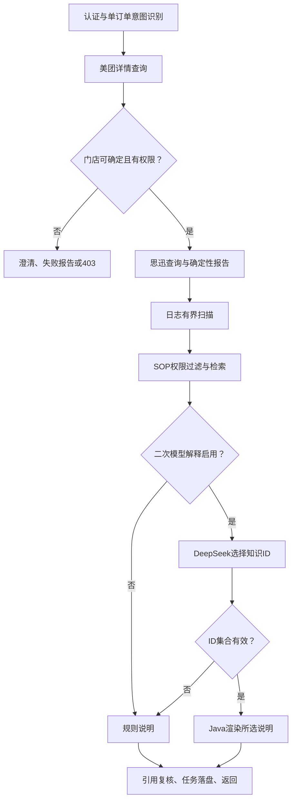

# Version 2 设计文档

## 目标与约束

在现有真实只读链路上增加可追溯的排障依据。保持 Java 17、Boot 4.1.1、Spring AI 2.0.2 和现有 SDK 隔离方案；本次不调整依赖或迁移框架。业务事实以文档17为准，不用日志未命中推导美团漏推，不用流水存在推导过账，不把超时推导成未执行。

用户明确不使用 Mock、不新增/执行测试、没有测试环境。本次只交付代码、配置、文档与手工验证设计，不启动真实应用或连接业务服务。

## 调用链

`DiagnosisWorkflow` 保持一个请求内的同步调用及并发信号量。V2 增强发生在原查询结果产生后、任务完成落盘前；思迅返回查询失败也可以继续收集授权日志线索。外层并发上限同时限制日志读取与二次模型调用，不新增无限队列。

## 模块边界

| 模块 | 输入与输出 | 不允许做的事 |
|---|---|---|
| `LocalLogEvidenceReader` | 已授权 operator/order/store → LogSearch | 不接受调用者路径，不执行 Shell/SSH，不返回原始行 |
| `LocalKnowledgeRetriever` | 已授权报告及日志标记 → KnowledgeSearch | 不先检索跨门店文档再删除，不把实际订单查询当知识检索 |
| `EvidenceExplanationSelector` | 最小化事实及候选说明 → Explanation | 不控制工具、SQL、业务结果、写入操作或自由文本结论 |
| `DiagnosisEnrichment` | V1报告 → V2报告 | 无可信门店时不开展本地取证 |
| `DiagnosisStore` | 任务所有者与最终报告 | 不是多实例恢复引擎或防篡改审计平台 |

## 日志算法和资源边界

1. 重复校验 operator 对 app_poi_code 的授权。读取关闭时返回 DISABLED。
2. 只枚举管理员配置目录的直接子项；检查文件 glob；不递归、不解压、不跟随最终文件符号链接。匹配文件最多 `max-files`，目录总枚举最多其10倍。
3. 对入选集合按文件名字典序读取，不声称先查最近文件。超过数量时，文件系统枚举顺序可能影响入选集合；因此明确 PARTIAL。
4. 按文件打开前的大小读取，不追随持续追加。字节数为全部扫描文件累计；行内容缓冲最多 `max-line-bytes`，超长行整行跳过。
5. 只处理 LF 结束的完整行。末尾未换行的内容按可能仍在写入处理；解码失败整行跳过。
6. 同行提取明确的订单字段与美团门店字段；各自所有识别值必须恰好构成请求对应的单元素集合。不做子串单号匹配，不把思迅 branch_no 当美团门店。
7. 对匹配行分类，输出 L 证据。命中数量、总字节数、协作式时间预算任一耗尽即停止；任何截断都暴露为 PARTIAL。
8. 读前后比较文件身份、长度、修改时间；变化标为 FILE_CHANGED。日志可继续产生，但系统不提供原子日志快照或业务时间线。

默认20文件、20MiB总扫描、单行16KiB、20命中、3秒。配置还设上限，不能通过 API 调大。输入流有小缓冲预读，`bytesScanned` 指业务扫描消费的字节量，不是操作系统底层I/O精确计数。时间预算在枚举/读取循环检查，不能中断阻塞在网络文件系统内核I/O的线程，因此部署应优先使用本地只读副本；不承诺硬实时超时。

最终文件使用 NOFOLLOW_LINKS，但父目录、挂载点和配置由可信管理员控制。该模块不是对恶意本机管理员或并发路径替换攻击的完整文件系统沙箱。主机权限应使普通调用者不能改日志来源和目录结构。

### 日志标记的知识含义

同一行出现 SQLException/SQLServerException 只证明字符串共现，不能证明本次同步失败由该异常导致；需核对事件时间、调用阶段和后续成功记录。网络超时同样不能证明下游未执行。K05/K06 编码这些保守排障规则，没有虚构已发生事故。

## 本地知识和 RAG 的范围

知识目录是一个 UTF-8 JSON 数组，默认内置6条通用 SOP；可通过 `file:` 指向管理员维护的本地文件。拒绝 HTTP 等网络来源，读取上限1MiB，条目最多500（默认100），校验唯一ID、长度、枚举及范围后加载为不可变快照。

`shared=true` 只用于通用知识，要求 stores 为空；私有知识 shared=false 且 stores 非空，必须精确匹配已授权门店，禁止 `*`。变更文件后需要重启应用；不是实时知识发布服务。修改内容应提升 version，同时生成新的 catalog/content SHA-256。

检索依据是受控的 outcome 标签与异常类别，属于结构化条件检索，不是 Embedding、BM25 或向量相似度排序。后续若引入更大知识库，可在此接口内增加分块、向量检索、重排与评测，但权限过滤和引用校验必须保留。

## 模型约束与引用校验

DeepSeek 只返回 `selectedIds`。服务检查数量1–3、去重、所有ID属于本次检索候选集，再从服务端候选映射渲染文字。模型生成的自由文本不会进入最终解释，也无法修改 outcome、postingStatus 或 replayExecuted。错误/超时/非法引用均回退规则说明。

对模型的限制从“要求它说真话”收敛为“只允许从适用的审核内容中选择”。这仍不证明选择最优；知识本身错误、适用标签配置错误或模型省略重要候选都需要人工治理。原始确定性报告和完整候选列表仍保留在响应中。

引用检查发生在检索后、模型选择后及历史任务读取时。历史引用要求当前条目仍存在且可见，version 和内容哈希仍一致。撤回或变更后拒绝整份历史报告，避免旧权限快照继续公开知识。当前存储是应用专用文件，哈希不是签名，不能防本机高权限篡改。

## 故障行为

| 故障 | 行为 |
|---|---|
| 美团失败/806/超窗，门店未知 | 保留原结果，details=null，不搜索本地日志 |
| 思迅失败 | outcome=POS_QUERY_FAILED；日志/知识可继续；计数不置零 |
| 日志未配置/不可读/截断 | 分别 DISABLED/UNAVAILABLE/PARTIAL；不改思迅结果 |
| 知识启用但目录无效 | 启动失败，避免静默加载不受控知识 |
| 知识禁用/无匹配 | 不调用二次模型，不编造说明 |
| 二次模型失败 | RULE_FALLBACK；原有意图模型失败仍按V1停止业务查询 |
| 历史知识撤回或范围变更 | GET返回403，重新诊断获取当前版本 |
| 任务写盘失败 | 沿用原有错误处理，不把未持久化结果宣称为已完成 |

## 运维与后续边界

单实例本地 JSON 持久化，无自动重试和重启续跑。中断仍可能遗留 RUNNING。日志读取与知识选择是只读过程；没有正式补推接口，所以不能用这个版本直接替代原临时 test 完成写入。

下一步接入实际日志格式、独立事件时间和请求阶段后，才能提高根因判断可信度；具备可核验的补推入口、幂等和审批契约后，再开发写操作闭环。
