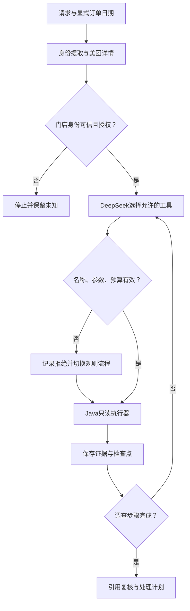

# Version 3 设计与调用链

## 边界

继续 Java 17、Boot 4.1.1、Spring AI 2.0.2 和 DeepSeek。新增 `com.github.mwiede:jsch:2.28.8` 做 SFTP。保留模块化单体，模型只选择读工具，最终事实和修复阻断由 Java 计算。

## 方法级路径

1. `AgentDiagnosisController.diagnose` 取得认证主体及 `Request(message, orderDate)`。
2. `AgentDiagnosisService.diagnose` 获取共享 `DiagnosisCapacity`，建立 `AgentContext`，先写初始检查点。日期缺失或无效时直接返回，任何模型/业务调用均不发生。
3. `OrderIntentExtractor.extract` 沿用 V2：确定性订单候选验证 + DeepSeek 意图提取。日期仅从结构化字段获得。日期合法性按日志时区计算，不对平台近5天窗口做未经核验的120小时推断。
4. `execute(ORDER, JAVA_IDENTITY_GATE)` 调用 `OrderDetailPort.query`。必须先完成可靠订单身份与门店权限检查，才记录平台证据并允许查询思迅、日志。806/超窗且门店无法确定时停止，不能靠用户日期绕过授权。
5. `DeepSeekDiagnosisPlanner.start` 创建本次任务消息列表；不会注入原始请求、订单报文或服务器配置。
6. `available` 动态提供 POS 与 LOGS 中尚未尝试的工具；两项都结束后提供 KNOWLEDGE。模型可选择先查流水或先查日志，不允许并行批量调用或重复查询。
7. `DeepSeekDiagnosisPlanner.next` 调用 `ChatModel.call(Prompt)`，通过 `ToolCallingChatOptions` 发送原生工具定义；拿到 `AssistantMessage.ToolCall` 后验证名称、function类型、调用ID、参数为空对象、一次一个调用。
8. `execute` 再核验当前门店授权和允许集合，写 STARTED 检查点，实际调用适配器，保存观测及完成检查点。
9. `observe` 将 Assistant tool call 和匹配调用ID的 `ToolResponseMessage` 加入单任务历史。下一轮模型看到的是流水状态、日志类别、接收标记状态、已调用工具等最小信息。
10. 调查完成、超预算或身份失败后，`AgentReportAssembler.snapshot` 构建业务事实、引用校验和 `RepairPlan`；`AgentRunStore.save` 保存后返回。
11. `GET /api/v1/diagnoses/agent/{taskId}` 检查记录所有者、当前门店授权、当前 SOP 版本及内容哈希。

`order.detail.query` 是固定的身份前置工具，不允许模型跳过或重复调用。模型原生函数名使用 `pos_flow_query`、`logs_search`、`knowledge_search`；业务轨迹使用点分名称。工具参数均为 `{}`，订单、门店、日期从服务端 Context 注入，不允许模型更换身份、扩大日期或选择文件。

## 为什么不用框架自动执行工具

Spring AI 2 的底层 `ChatModel` 返回工具调用；工具执行由外部控制。此处不经过自动 `ToolCallingAdvisor`，也不提供可执行的全局 ToolCallback bean。发送给模型的 callback 仅含定义，若被意外执行会抛错。执行器显式调用既有适配器，避免通用工具解析器绕过允许集合。

原生工具响应非法、模型调用失败、提前结束或重复 call ID：记一条安全错误码，后续改由规则顺序执行剩余允许步骤。不重试已调用的业务工具，不将错误模型文字写入报告。初始意图识别失败仍沿用 V2 停止行为。

## 上下文与持久化

`AgentContext` 仅在当前请求内可变，包含任务ID、所有者、订单号、显式日期、授权后的平台身份、流水快照、日志证据、SOP、尝试集合和步骤。它不是跨用户聊天记忆。模型消息列表不落盘；安全结果和轨迹按所有者存为 `data/diagnoses/agent-v3/{taskId}.json`。

工具前后都保存；写盘失败立即停止后续调用。单实例通过原子替换避免半份 JSON。每个进程生成 epoch，读取其他 epoch 的 RUNNING 记录时展示 INTERRUPTED，不自动重新查询。文件并非签名审计，也不是分布式 Workflow 数据库。调用是同步的，POST 返回之前不会提前返回 taskId；中断后可由管理员从任务目录定位 ID，再由所有者查询。

## 预算

默认共享并发2、最多8条步骤（含身份工具和规划拒绝）、任务120秒、每次规划最多300输出token。预算在外部调用前后检查；任务超时是协作式，不能保证在120秒硬中断已发出的模型/SDK/JDBC请求，仍依赖各自连接与读取超时。没有无限后台线程池和无限重试。

SFTP 单次默认30秒，watchdog 到时断开会话；连接/读取超时5秒。扫描默认60文件、枚举2000项、压缩32MiB、解压128MiB、每行64KiB、30条命中、邻近200行检查窗口。这些是应用消费量约束，底层网络缓冲和压缩库预读存在额外开销；不声称精确限制主机I/O。

## 远程扫描

1. 重新检查门店授权；无日期不读取，未配置则 DISABLED。
2. 用固定管理员主机、私钥、known_hosts 建立只读 SFTP；强制 `StrictHostKeyChecking=yes`，不使用密码回退。
3. 在固定目录枚举安全文件名：`b-push-center-server.log.D.[A-Za-z0-9_-]+.gz`，只支持直接子项。检查普通文件及规范路径，拒绝符号链接；目录所有权、挂载及竞态仍由可信管理员保障。
4. 当天优先，其次前一天、后一天，各日按文件名字典序。达到枚举限制可能遗漏文件，明确 PARTIAL。日期找不到归档也标记缺口。
5. SFTP 流式读取并由 Java `GZIPInputStream` 解压，不在服务器执行 `zcat`/`grep`，不将原始日志写到本地文件。
6. 逐行有界解析。精确token避免订单号子串误匹配；出现冲突的显式订单/门店字段则整行跳过。无完整身份的行最多返回 ORDER_MENTION 元数据；相邻行不因距离近就获得身份。
7. 完整身份匹配才分类异常；固定回调标记经管理员配置后才能识别接收阶段。解析行首 `yyyy-MM-dd HH:mm:ss[.SSS]` 或T分隔形式，按日志时区转 Instant，无法解析为 null。输出事件按可解析时间排序，未知在后；并不证明业务先后因果。
8. 文件读前后大小或mtime变化、损坏gzip、字符解码失败、长行、未换行尾部、超限均记录限制；未命中永远不证明“未收到订单”。

## 官方接口核对来源

- [Spring AI Tool Calling](https://docs.spring.io/spring-ai/reference/api/tools.html)
- [Spring AI 2 工具执行变更](https://spring.io/blog/2026/06/15/spring-ai-composable-tool-calling/)
- [ToolCallingChatOptions API](https://docs.spring.io/spring-ai/docs/current/api/org/springframework/ai/model/tool/ToolCallingChatOptions.Builder.html)
- [ToolCallback API](https://docs.spring.io/spring-ai/docs/current/api/org/springframework/ai/tool/ToolCallback.html)
- [JSch releases](https://github.com/mwiede/jsch/releases)

已核对公开API文档；本环境依赖解析失败，因此不能把文档核对当作完整编译通过。
