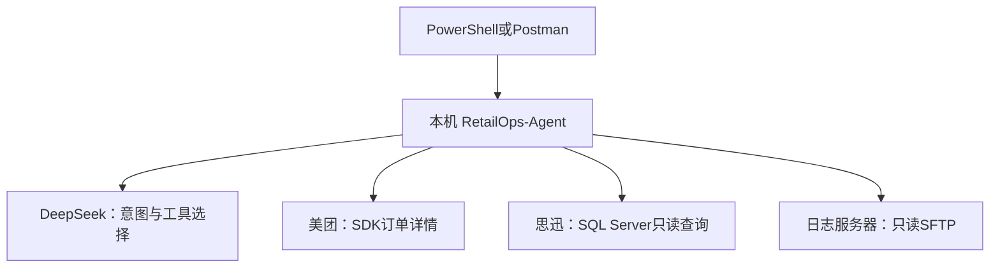
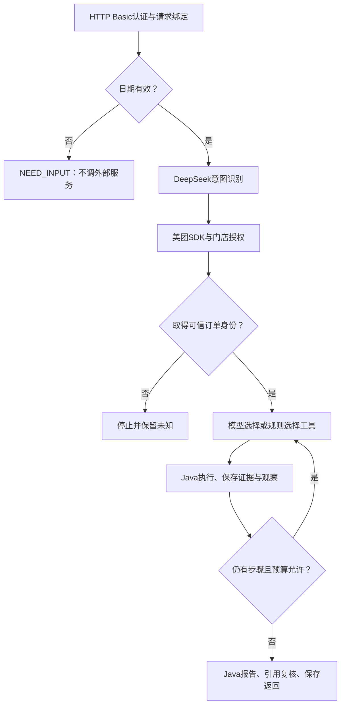

# Version3 真实验收手册：环境、启动、调用、源码链路与结果核对

本文依据已合并的 V3 源码编写，核对基线为 master 提交 `11a7f04f4b6c0cf9120232082d70c443f341b2b2`。面向 Windows 10、项目 JDK17、Maven Wrapper、IDEA，以及公司已有的美团推送服务和思迅数据库。

本文是操作说明和待执行的验收方案，不是“已经实测成功”的报告。V3 已完成静态检查，开发环境的完整 Maven 构建因 Maven Central DNS 失败受阻；完整编译、应用启动、模型及业务联调仍需你本地确认。本次文档编写没有运行测试、启动应用或连接生产服务。

**你只需启动一个新的 Java 应用：`com.yu.retailops.RetailOpsAgentApplication`。然后通过 HTTP 调用 V3 接口。不要直接运行旧项目里的补推 test，也不需要逐个手动运行适配器类。**

## 目录

1. [当前系统做什么、依赖哪些环境](#1-当前系统做什么依赖哪些环境)
2. [准备本地项目和JDK17](#2-准备本地项目和jdk17)
3. [准备账号、配置和SDK](#3-准备账号配置和sdk)
4. [启动应用：PowerShell或IDEA](#4-启动应用powershell或idea)
5. [第一轮：验证HTTP入口和鉴权](#5-第一轮验证http入口和鉴权)
6. [第二轮：美团SDK和思迅真实查询](#6-第二轮美团sdk和思迅真实查询)
7. [第三轮：开启远程日志与模型工具规划](#7-第三轮开启远程日志与模型工具规划)
8. [完整HTTP调用与历史任务读取](#8-完整http调用与历史任务读取)
9. [当前源码究竟怎样执行](#9-当前源码究竟怎样执行)
10. [上下文、模型消息和任务文件](#10-上下文模型消息和任务文件)
11. [看懂返回结果和验收标准](#11-看懂返回结果和验收标准)
12. [IDEA断点与常见故障](#12-idea断点与常见故障)
13. [验收记录表与完成顺序](#13-验收记录表与完成顺序)

## 1. 当前系统做什么、依赖哪些环境

V3 处理的是**单个美团销售订单的只读诊断**：从用户输入识别订单，查询美团详情确认门店身份，查询思迅流水和日志，检索适用SOP，最后返回诊断与不可执行的处理计划。

当前没有正式补推执行接口。即使你输入“帮我补推”，系统也只诊断，`replayExecuted=false`、`repairPlan.executable=false`。

### 1.1 哪些环境要启动

| 环境/组件 | 本次是否需要 | 谁来启动或维护 |
|---|---|---|
| 本机JDK17 | 需要 | 本项目使用 `F:\ayd\jdk-17`，不改全局JDK8 |
| RetailOps-Agent | 需要 | 你在本机启动，本手册提供命令 |
| DeepSeek API | 需要访问 | 云端服务；本机设置有效API Key和可访问网络 |
| 美团订单详情API | 需要访问 | 美团提供；本机使用公司授权的SDK和凭证 |
| 思迅SQL Server | 需要访问 | 使用公司已有实例，不在本机新建数据库 |
| 原 `b-push-center-server` 服务 | 需要已有业务日志 | 继续由公司按现有方式运行；本次不另起一个重复消费订单的实例 |
| 日志服务器的SFTP | 第三轮需要 | 管理员提供专用只读账号、目录和主机指纹 |
| 公司内网/VPN | 视部署需要 | 让本机能连接数据库和日志服务器 |
| Docker、PostgreSQL、pgvector、Redis、MQ | 当前V3不需要 | 不要为了本次验收启动另一个RAG项目的环境 |
| 前端页面/Swagger | 当前没有相应入口 | 使用PowerShell或Postman调用API |



SOP 从项目内的 `src/main/resources/knowledge/meituan-sales.json` 加载；任务记录写在本机 `data/diagnoses/agent-v3/`。当前没有向量数据库依赖。

### 1.2 当前工程声明的版本

以 [pom.xml](pom.xml) 为准：Java 17、Spring Boot 4.1.1、Spring AI 2.0.2、JSch 2.28.8。以上是代码声明的版本，不等于本环境已经完成全量兼容性验证。美团SDK为管理员提供的本地JAR，不通过临时编写的SDK替代品运行。

## 2. 准备本地项目和JDK17

### 2.1 获取master

在**你实际的项目根目录**打开PowerShell，确认该目录能看到 `pom.xml`、`mvnw.cmd`、`src`、`config`：

```powershell
Get-Location
Test-Path .\pom.xml
Test-Path .\mvnw.cmd
git status --short
```

两个 `Test-Path` 应为 `True`。如果有你自己的未提交修改，先保留好，不要用强制重置覆盖。工作区可以切换分支时：

```powershell
git switch master
git pull --ff-only origin master
```

### 2.2 会话级使用JDK17

```powershell
$env:JAVA_HOME = 'F:\ayd\jdk-17'
$env:Path = "$env:JAVA_HOME\bin;$env:Path"
& "$env:JAVA_HOME\bin\java.exe" -version
.\mvnw.cmd -version
```

预期：Java版本为17；Maven输出的Java版本/Java home也指向本项目JDK17。关闭这个PowerShell后，临时环境变量消失，不会修改系统全局JDK8配置。

本项目使用 `mvnw.cmd`，无需配置系统 `mvn`。

### 2.3 先完成一次编译打包

```powershell
.\mvnw.cmd --batch-mode --no-transfer-progress '-Dmaven.test.skip=true' package
if ($LASTEXITCODE -ne 0) { throw 'Build failed. Fix the build error before starting the app.' }
Test-Path .\target\RetailOps-Agent-0.0.1-SNAPSHOT.jar
```

预期：Maven输出 `BUILD SUCCESS`，JAR检查为 `True`。`maven.test.skip=true` 跳过测试编译和执行，不会启动Spring或连接业务服务。

如果依赖下载、父POM解析、Java类型或Spring AI API编译失败，先解决该错误；不能跳过这一步就认定V3已经能运行。此前开发环境遇到的是 `repo.maven.apache.org` DNS解析失败，不代表你本机一定有相同问题。

## 3. 准备账号、配置和SDK

### 3.1 先分清四类账号

| 账号/密钥 | 作用 | 配置位置 |
|---|---|---|
| RetailOps操作员，例如 `operator` | HTTP Basic登录本应用、限定可访问门店 | `retailops.users`，保存BCrypt哈希 |
| 美团App ID/App Secret | SDK查询平台订单 | `MEITUAN_APP_ID` / `MEITUAN_APP_SECRET` |
| 思迅只读数据库账号 | 查询门店映射、销售流水、支付流水 | `POS_READ_USERNAME` / `POS_READ_PASSWORD` |
| 日志服务器SFTP账号 | 读取指定目录的归档日志 | `retailops.agent.remote-logs`及专用私钥 |

另外还需要 `DEEPSEEK_API_KEY`。操作员登录密码不是数据库密码，也不是美团Secret。

### 3.2 复制配置，保留已有配置

```powershell
if (-not (Test-Path .\config\application-local.yml)) {
    Copy-Item .\config\application-local.example.yml .\config\application-local.yml
}
New-Item -ItemType Directory -Path .\config\meituan-sdk -Force | Out-Null
if (-not (Test-Path .\config\meituan-sdk\environment.properties)) {
    Copy-Item .\config\meituan-sdk.example\environment.properties .\config\meituan-sdk\environment.properties
}
```

应用通过 `spring.config.import=optional:file:./config/application-local.yml` 加载该文件。**正常步骤不要求启用名为local的Spring Profile**；`application-local.yml` 在这里是显式导入文件。

所有相对路径均以进程工作目录为基准，因此启动目录须为项目根目录。

### 3.3 编辑美团SDK与门店映射

打开 `config/application-local.yml`，沿用示例结构并改成实际值：

```yaml
retailops:
  meituan:
    sdk-jar: 'E:/Repositories/Maven/cn/com/baby/shangou-platform-open-sdk/1.0.27.1-SNAPSHOT/shangou-platform-open-sdk-1.0.27.1-SNAPSHOT.jar'
    sdk-config-directory: './config/meituan-sdk'
    app-id: '${MEITUAN_APP_ID}'
    app-secret: '${MEITUAN_APP_SECRET}'
  users:
    operator:
      password-hash: '${RETAILOPS_OPERATOR_PASSWORD_HASH}'
      stores:
        - 'ACTUAL_APP_POI_CODE'
  pos-routes:
    '[ACTUAL_APP_POI_CODE]':
      jdbc-url: '${POS_JDBC_URL}'
      username: '${POS_READ_USERNAME}'
      password: '${POS_READ_PASSWORD}'
      schema: 'dbo'
      query-timeout-seconds: 5
  diagnostics:
    logs:
      enabled: false
    knowledge:
      enabled: true
      location: 'classpath:knowledge/meituan-sales.json'
    explanation-enabled: false
  agent:
    enabled: true
    planner-enabled: false
    remote-logs:
      enabled: false
      host: '${RETAILOPS_LOG_HOST:}'
      port: 22
      username: 'retailops_logs'
      private-key: '${RETAILOPS_LOG_PRIVATE_KEY:./config/ssh/retailops_logs_key}'
      known-hosts: '${RETAILOPS_LOG_KNOWN_HOSTS:./config/ssh/known_hosts}'
      directory: '/logs'
      zone-id: 'Asia/Shanghai'
      charset: 'UTF-8'
      callback-received-marker: ''
```

这是第一、二轮的配置：关闭V3规划和远程日志，先减少外部环节。其余预算配置从项目的 `application.properties` 取得。

注意：

- 将两处 `ACTUAL_APP_POI_CODE` 改成同一个真实的**美团门店编码**，不要填思迅的 `branch_no`。
- `pos-routes` 的方括号是Spring Map键绑定写法，保留外层单引号和方括号，仅替换中间编码。
- `sdk-jar` 改成你实际存在的JAR路径。示例是已核验过的SDK坐标对应路径，不保证每台电脑都有该文件。
- 同一YAML中只保留一个 `retailops:` 根节点，避免把后贴的配置覆盖前面的配置。
- `diagnostics.logs` 是V2本地文本读取；`agent.remote-logs` 才是V3远程gzip读取，两者不是同一个开关。
- `planner-enabled=false` **只关闭V3工具规划**。`OrderIntentExtractor` 仍使用DeepSeek识别业务意图，API Key仍必须可用。
- V3的报告由 `AgentReportAssembler` 生成；V2的 `diagnostics.explanation-enabled` 不会为V3额外启动解释模型调用。

### 3.4 核对SDK配置文件

`config/meituan-sdk/environment.properties` 使用仓库示例：

```properties
env=1
url=https://waimaiopen.meituan.com
isSig=1
sdkVersion=1.0.27.1-SNAPSHOT
socketTimeOut=5000
connectTimeOut=3000
connectRequestTimeOut=3000
maxTotal=4
defaultMaxPerRoute=4
maxPerRoute=4
```

`MeituanSdkOrderAdapter` 构造时会检查JAR、配置文件、签名模式、固定平台地址及超时。它使用隔离类加载器访问SDK，应用源码不会直接import该旧SDK类。不要因为IDEA里没看到普通Maven SDK依赖就另加一套重复依赖。

该配置选择美团真实接口；只有查询被调用后才发出详情请求。启动时的静态类检查不代表SDK已真实调用成功。

### 3.5 创建操作员密码哈希

在交互式PowerShell运行：

```powershell
.\scripts\New-PasswordHash.ps1
```

脚本使用JDK17编译并生成运行classpath，然后执行 `com.yu.retailops.support.PasswordHashTool.main`。它不启动Spring、不连接模型或业务服务。按提示输入至少12个字符的操作员密码，终端会输出以 `{bcrypt}` 开头的哈希。

将完整哈希设到**准备启动应用的PowerShell窗口**：

```powershell
$env:RETAILOPS_OPERATOR_PASSWORD_HASH = '在这里粘贴完整的{bcrypt}哈希'
```

必须使用单引号，避免PowerShell展开BCrypt文本里的 `$`。稍后HTTP登录时输入你刚设置的**原始密码**，不是这段哈希。若工具提示无交互Console，请在独立PowerShell终端运行，不要把密码放在Java命令参数里。

### 3.6 设置真实访问凭证

下面的辅助函数仅用于在当前PowerShell里输入密钥，避免把真实密钥直接写入命令历史：

```powershell
function Set-SessionSecret {
    param([Parameter(Mandatory = $true)][string]$Name)
    $secretValue = Read-Host -Prompt $Name -AsSecureString
    $secretPointer = [Runtime.InteropServices.Marshal]::SecureStringToBSTR($secretValue)
    try {
        [Environment]::SetEnvironmentVariable(
            $Name,
            [Runtime.InteropServices.Marshal]::PtrToStringBSTR($secretPointer),
            [EnvironmentVariableTarget]::Process
        )
    } finally {
        [Runtime.InteropServices.Marshal]::ZeroFreeBSTR($secretPointer)
    }
}

$env:MEITUAN_APP_ID = Read-Host 'MEITUAN_APP_ID'
Set-SessionSecret -Name 'MEITUAN_APP_SECRET'
Set-SessionSecret -Name 'DEEPSEEK_API_KEY'
$env:DEEPSEEK_MODEL = 'deepseek-chat'
$env:POS_READ_USERNAME = Read-Host 'POS_READ_USERNAME'
Set-SessionSecret -Name 'POS_READ_PASSWORD'
$env:POS_JDBC_URL = 'jdbc:sqlserver://YOUR_SQLSERVER:1433;databaseName=YOUR_DATABASE;encrypt=true;trustServerCertificate=false'
```

数据库主机、端口、库名按公司实际值填写；TLS证书及信任配置按数据库部署要求处理，不以关闭验证作为默认解决方法。密码在应用运行时仍需作为环境变量供进程读取，不代表它是操作系统级密钥库。

检查必需变量是否设置，但不打印变量内容：

```powershell
$requiredNames = @(
    'MEITUAN_APP_ID', 'MEITUAN_APP_SECRET', 'DEEPSEEK_API_KEY',
    'POS_JDBC_URL', 'POS_READ_USERNAME', 'POS_READ_PASSWORD',
    'RETAILOPS_OPERATOR_PASSWORD_HASH'
)
foreach ($name in $requiredNames) {
    if ([string]::IsNullOrWhiteSpace([Environment]::GetEnvironmentVariable($name, 'Process'))) {
        throw "Missing environment variable: $name"
    }
}
```

## 4. 启动应用：PowerShell或IDEA

### 4.1 推荐先用PowerShell启动

在已经设置上述变量的**窗口A**，保持工作目录为项目根目录：

```powershell
& "$env:JAVA_HOME\bin\java.exe" -jar .\target\RetailOps-Agent-0.0.1-SNAPSHOT.jar
```

保持该窗口运行。预期看到Spring Boot启动完成、服务监听8080；没有未解决的配置异常。默认地址为 `127.0.0.1:8080`，因此只有本机能直接访问。

另开**窗口B**执行HTTP请求，避免把请求命令输入到正在运行Java的窗口里。窗口B不需要美团、数据库或DeepSeek密钥，只需要操作员HTTP凭证和脚本所在目录。

启动成功说明应用装配和配置检查已完成，**不能证明**美团、数据库和SFTP都已连通。思迅连接池按首次查询懒创建；SFTP只有日志工具被调用时才连接。

### 4.2 用IDEA启动与调试

主启动类：

- 文件：[RetailOpsAgentApplication.java](src/main/java/com/yu/retailops/RetailOpsAgentApplication.java)
- 全限定名：`com.yu.retailops.RetailOpsAgentApplication`
- 方法：`main(String[] args)`

在IDEA设置：

| 位置 | 设置 |
|---|---|
| Project Structure → Project SDK | JDK17，路径 `F:\ayd\jdk-17` |
| Project Structure → Modules → Module SDK | 使用Project SDK或明确JDK17 |
| Maven设置的Importer/Runner JDK | 本项目JDK17，具体菜单名称按IDEA版本为准 |
| Run/Debug Configuration → Main class | `com.yu.retailops.RetailOpsAgentApplication` |
| Run/Debug Configuration → JRE | JDK17 |
| Working directory | 项目根目录，即包含pom.xml和config的目录 |
| Environment variables | 第3节的业务凭证变量和操作员哈希 |
| Active profiles | 正常流程可留空，外部文件已显式导入 |

**独立PowerShell里设置的环境变量不会自动进入已经启动的IDEA。** 用IDEA运行时须在该运行配置单独填写。不要勾选共享并提交含凭证的运行配置。不要同时让IDEA和窗口A占用同一个8080端口。

### 4.3 本系统没有独立健康检查入口

当前代码未提供 `/health`、`/api/v1/health`、Actuator或首页。浏览器打开根路径出现401/403，不足以判断启动失败。按下一节调用真实存在的API验证入口。

## 5. 第一轮：验证HTTP入口和鉴权

这一步使用“缺少日期”的请求验证认证、Controller、参数处理及本地任务保存。**在日期检查处返回，不调用DeepSeek、美团、思迅或SFTP。** 应用启动仍需要第3节的有效配置文件和SDK文件。

在窗口B的项目根目录执行：

```powershell
$baseUrl = 'http://127.0.0.1:8080'
$credential = Get-Credential -UserName 'operator' -Message 'RetailOps operator login'
if (-not $credential) { throw 'Credentials were not provided.' }
$pair = '{0}:{1}' -f $credential.UserName, $credential.GetNetworkCredential().Password
$headers = @{ Authorization = 'Basic ' + [Convert]::ToBase64String([Text.Encoding]::UTF8.GetBytes($pair)) }
$probeBody = @{ message = 'Diagnose Meituan sale order 500540116926156' } | ConvertTo-Json
$probe = Invoke-RestMethod `
    -Uri ($baseUrl + '/api/v1/diagnoses/agent/meituan-sales') `
    -Method Post -Headers $headers `
    -ContentType 'application/json; charset=utf-8' `
    -Body ([Text.Encoding]::UTF8.GetBytes($probeBody)) `
    -TimeoutSec 30 -MaximumRedirection 0
$probe | Select-Object taskId, state, stopReason
```

预期：

| 字段 | 值 |
|---|---|
| `state` | `NEED_INPUT` |
| `stopReason` | `ORDER_DATE_REQUIRED` |
| `report.outcome` | `NEED_INPUT` |
| `steps` | 空数组，没有业务工具步骤 |
| `taskId` | 非空UUID |

这个例子的订单号只是请求格式示例，日期检查发生在订单提取之前，不会访问这笔订单。

HTTP 200只表示请求正常返回；它可以携带NEED_INPUT或STOPPED，不代表诊断成功。401通常先排查HTTP账号和原始密码；403可能是权限不满足。保留 `$headers` 供第8节GET使用，用完后清理；不要在终端打印Authorization。

## 6. 第二轮：美团SDK和思迅真实查询

### 6.1 挑选一笔适合验收的真实订单

选择你有权限、人工确认过的美团销售订单，最好是详情接口当前仍可查询的近期订单，并知道它的完整订单日期、美团门店编码和思迅预期流水状态。

不要反复使用本文固定的 `2026-11-08` 作为今后的验收日期。该日期只解释归档文件规则，实际运行须换成真实日期。超过平台查询窗口、无法获得可信门店身份时，当前V3会停止后续思迅和日志查询。

第一笔优先选已知两类流水均存在的正常订单，便于确认数据源和门店映射正确；不用先找一笔疑难故障订单。

### 6.2 暂时保持规划和日志关闭

第3节已设置：

```yaml
retailops:
  agent:
    planner-enabled: false
    remote-logs:
      enabled: false
```

修改外部配置后需重启应用，不是热更新。用窗口A按Ctrl+C停止，再用原启动命令启动；本轮仍保留DeepSeek Key用于初始意图识别。

### 6.3 调用仓库现有脚本

窗口B执行：

```powershell
$orderId = Read-Host 'Actual Meituan sale order ID'
$orderDate = Read-Host 'Actual order date (yyyy-MM-dd)'
$outputFile = '.\data\reports\v3-round2-{0}.json' -f (Get-Date -Format 'yyyyMMdd-HHmmss-fff')
.\scripts\Invoke-AgentDiagnosis.ps1 `
    -OrderId $orderId `
    -OrderDate $orderDate `
    -Username 'operator' `
    -OutputFile $outputFile
```

脚本会再次询问HTTP操作员密码，不会使用美团或数据库密码。它通过UTF-8发送JSON，最多等待240秒，禁止重定向，拒绝覆盖已有输出文件。运行这条命令会产生真实只读查询及模型用量。

读取保存的结果：

```powershell
$result = Get-Content -LiteralPath $outputFile -Raw -Encoding UTF8 | ConvertFrom-Json
$result | Select-Object taskId, state, stopReason
$result.report | Select-Object orderId, storeCode, outcome, postingStatus, replayExecuted, summary
$result.steps | Format-Table number, tool, decisionSource, status, durationMillis -AutoSize
$result.report.evidence | Where-Object id -eq 'E3' | Format-List
```

在身份通过、思迅查询成功、未超预算的前提下，应看到如下步骤。该表是预期结构，不是已执行结果：

| 步骤 | tool | decisionSource | status |
|---|---|---|---|
| 1 | `order.detail.query` | `JAVA_IDENTITY_GATE` | `FOUND` |
| 2 | `pos.flow.query` | `RULE_FALLBACK` | `QUERIED` |
| 3 | `logs.search` | `RULE_FALLBACK` | `DISABLED` |
| 4 | `knowledge.search` | `RULE_FALLBACK` | 有适用SOP时为 `RETRIEVED`，否则可能 `NO_MATCH` |

规则模式正常结束时 `stopReason=RULE_FALLBACK_COMPLETE`，这是你主动关闭规划的预期结果。此轮不验收远程日志能力。

### 6.4 对照思迅实际查询

`JdbcPosFlowAdapter.query(orderId, appPoiCode)` 先用当前美团门店查：

```sql
SELECT siss_storeid
FROM [dbo].[t_bd_mtbranch_info]
WHERE mt_storeid = @appPoiCode;
```

得到唯一且非空的 `siss_storeid` 后，将其去除首尾空白作为 `branch_no`，再查询两表计数。可在公司批准的数据库客户端用同一个只读账号人工对照：

```sql
-- 将值和dbo改为实际订单、门店及已配置schema；只读查询。
DECLARE @appPoiCode nvarchar(128) = N'ACTUAL_APP_POI_CODE';
DECLARE @orderId nvarchar(32) = N'ACTUAL_ORDER_ID';

SELECT siss_storeid
FROM [dbo].[t_bd_mtbranch_info]
WHERE mt_storeid = @appPoiCode;

-- 先确认上面的映射恰好一条且非空，再填入该映射结果。
DECLARE @branchNo nvarchar(128) = N'ACTUAL_SISS_STOREID';
SELECT
    (SELECT COUNT_BIG(*) FROM [dbo].[t_rm_saleflow_frommail]
     WHERE mail_orderid = @orderId AND branch_no = @branchNo) AS sale_count,
    (SELECT COUNT_BIG(*) FROM [dbo].[t_rm_payflow_frommail]
     WHERE mail_orderid = @orderId AND branch_no = @branchNo) AS pay_count;
```

应用使用JDBC占位参数，不是拼接用户SQL。这里是供人工核对的等价只读查询。确认数据库实例、库、schema及门店一致；如果业务正在处理，两个时间点的结果可能变化，不能把差异直接当代码错误。

验收重点：`E3.saleCount`、`E3.payCount` 与同范围人工查询相符；查询失败时保持UNKNOWN，不能变成0。两表均有记录只证明写入存在，过账状态仍未知。

## 7. 第三轮：开启远程日志与模型工具规划

### 7.1 先准备日志服务器访问条件

由管理员完成 [服务器权限说明](docs/version3/security.md) 和 [sshd配置示例](config/ssh/sshd_config.example) 中的部署。至少提供：

| 项目 | 需要明确的值 |
|---|---|
| 主机及端口 | 实际日志服务器地址、SSH端口，默认22 |
| 专用账号 | 示例 `retailops_logs`，仅用于读取日志 |
| 私钥 | 本机可读取的专用身份文件，不提交Git |
| known_hosts | 已通过可信渠道核对服务器指纹后保存的文件 |
| SFTP内目录 | 推荐 `/logs` |
| 实际物理目录 | `/data/service/b-push-center-server/logs` |
| 文件名 | `b-push-center-server.log.YYYY-MM-DD.*.gz` |
| 日志时区和编码 | 默认Asia/Shanghai、UTF-8；以服务器实际值为准 |
| 回调接收标记 | 从真实回调源码核对的固定日志文字；不确定则保持空值 |

推荐把物理日志目录只读挂载到chroot中的 `/logs`。因此Agent看到的是 `/logs`，不是主机文件系统的完整路径。仅把 `directory` 改成 `/logs` 并不会创建chroot或挂载。

数据库的SELECT权限不会保护服务器文件。服务器需要独立的只读SFTP配置、无写权限的目录、只读挂载及禁用Shell/转发。普通账号对父目录有写权限时，即使文件本身只读也可能删除文件；不要以“文件只读”代替完整部署核验。

### 7.2 在启动应用的窗口设置SFTP参数

先停止本机Agent，再在窗口A设置：

```powershell
$env:RETAILOPS_LOG_HOST = Read-Host 'Log server hostname or IP'
$env:RETAILOPS_LOG_PRIVATE_KEY = 'F:\retailops-secrets\retailops_logs_key'
$env:RETAILOPS_LOG_KNOWN_HOSTS = 'F:\retailops-secrets\known_hosts'
Test-Path -LiteralPath $env:RETAILOPS_LOG_PRIVATE_KEY
Test-Path -LiteralPath $env:RETAILOPS_LOG_KNOWN_HOSTS
```

两个文件路径检查应为True，内容由你和管理员保管，不需要上传给模型。当前代码使用无交互公钥认证，没有带口令私钥的解锁入口；如公司只允许带口令密钥，需要另行扩展凭证接入，不应把口令硬写到代码。

如果本机安装了OpenSSH SFTP客户端，可以先做只读连通性检查；没有该客户端不影响Java JSch本身运行：

```powershell
sftp -P 22 `
    -i "$env:RETAILOPS_LOG_PRIVATE_KEY" `
    -o StrictHostKeyChecking=yes `
    -o "UserKnownHostsFile=$env:RETAILOPS_LOG_KNOWN_HOSTS" `
    "retailops_logs@$env:RETAILOPS_LOG_HOST"
```

进入SFTP提示符后只查看：

```text
pwd
ls /logs
bye
```

不要关闭主机密钥校验来绕过报错。能够列目录只证明认证和目录访问可用，不证明文件读取、gzip内容和订单匹配均正常；这些在Agent实际调用中核对。

### 7.3 打开日志与规划开关

在现有 `config/application-local.yml` 的对应节点修改：

```yaml
retailops:
  agent:
    planner-enabled: true
    remote-logs:
      enabled: true
      host: '${RETAILOPS_LOG_HOST}'
      port: 22
      username: 'retailops_logs'
      private-key: '${RETAILOPS_LOG_PRIVATE_KEY}'
      known-hosts: '${RETAILOPS_LOG_KNOWN_HOSTS}'
      directory: '/logs'
      zone-id: 'Asia/Shanghai'
      charset: 'UTF-8'
      callback-received-marker: ''
```

保留其他基础配置，重启应用，再用第二轮的脚本对同一笔授权订单发起一次新诊断，输出文件使用新时间戳。

想更细分定位时，可以先只开启 `remote-logs.enabled=true`，保持 `planner-enabled=false` 验证SFTP；日志工具能读取后再打开规划。每次改变配置都需重启。

### 7.4 应该检查什么

```powershell
$result = Get-Content -LiteralPath $outputFile -Raw -Encoding UTF8 | ConvertFrom-Json
$result.steps | Format-Table number, tool, decisionSource, status, durationMillis -AutoSize
$result.remoteLogs | Select-Object orderDate, requestedDates, datesWithoutArchives, compressedBytes, contextLinesInspected, callbackReceipt
$result.remoteLogs.search | Select-Object status, filesScanned, bytesScanned, linesScanned
$result.remoteLogs.search.limitations
$result.remoteLogs.search.matches | Format-Table id, source, lineNumber, category -AutoSize
$result.remoteLogs.timeline | Format-Table evidenceId, eventTime, stage, association -AutoSize
```

这里的 `$outputFile` 必须指向第三轮新保存的文件，不要误读第二轮日志关闭的结果。

对 `2026-11-08`，请求扫描顺序为：

1. `b-push-center-server.log.2026-11-08.*.gz`
2. `b-push-center-server.log.2026-11-07.*.gz`
3. `b-push-center-server.log.2026-11-09.*.gz`

程序通过SFTP读取压缩字节，再在Agent进程里用 `GZIPInputStream` 解压，**不会在服务器运行** `zcat ... | grep -A 200 ...`。当前只识别固定前缀、日期以及字母/数字/下划线/短横线组成的归档后缀；不递归目录，不包含未压缩活动日志。

原人工命令的后200行可能夹杂其他线程、其他订单。V3只记录窗口内已检查行数，各行仍独立核验身份；没有可靠身份的邻行不会因为靠近命中行就作为目标订单的异常证据。`contextLinesInspected` 大于0不代表返回了200行文本。

### 7.5 什么情况下才会确认接收标记

当前识别要求同时满足：

1. 同行明确订单字段唯一对应目标订单；可识别字段包括 `orderId`、`order_id`、`mailOrderId`、`mail_orderid`、`order`。
2. 同行明确美团门店字段唯一对应授权门店；可识别字段为 `app_poi_code` 或 `appPoiCode`，不能用思迅branch_no替代。
3. 同行包含管理员核对过的 `callback-received-marker` 固定文字。

满足后返回 `callbackReceipt=RECEIPT_MARKER_FOUND`。仅出现订单号时，关联级别为 `ORDER_ID_ONLY_UNCONFIRMED`，接收状态仍为UNKNOWN。接收标记留空时不会产生“已确认回调接收”的结论。

如果你的日志将接收说明、订单号、门店分成多行，当前版本不自动跨行拼接为一次接收事件。应先提供脱敏日志格式及对应打印代码，再决定如何增加可靠关联规则，不能为了让验收“通过”随便填一个常见字符串。

## 8. 完整HTTP调用与历史任务读取

### 8.1 接口地址

| 操作 | HTTP接口 |
|---|---|
| V3新诊断 | `POST /api/v1/diagnoses/agent/meituan-sales` |
| V3历史任务 | `GET /api/v1/diagnoses/agent/{taskId}` |
| V2固定流程（不是本手册目标） | `POST /api/v1/diagnoses/meituan-sales` |

没有 `/order.detail.query` 或 `/logs.search` 这样的独立HTTP端点。这些是后端内部工具名，实际调用统一从V3 Controller进入。

### 8.2 不使用脚本，直接PowerShell请求

复用第一轮窗口B里的 `$baseUrl`、`$headers`：

```powershell
$orderId = Read-Host 'Actual Meituan sale order ID'
$orderDate = Read-Host 'Actual order date (yyyy-MM-dd)'
$body = @{
    message = "Diagnose Meituan sale order $orderId"
    orderDate = $orderDate
} | ConvertTo-Json
$result = Invoke-RestMethod `
    -Uri ($baseUrl + '/api/v1/diagnoses/agent/meituan-sales') `
    -Method Post -Headers $headers `
    -ContentType 'application/json; charset=utf-8' `
    -Body ([Text.Encoding]::UTF8.GetBytes($body)) `
    -TimeoutSec 240 -MaximumRedirection 0
$result | ConvertTo-Json -Depth 30
```

这是新一次诊断，会重新查询外部服务，不是读取上一次结果。远程调用RetailOps本身时应使用管理员提供的HTTPS入口；示例HTTP仅用于本机回环地址。

### 8.3 Postman设置

- Method：POST。
- URL：`http://127.0.0.1:8080/api/v1/diagnoses/agent/meituan-sales`。
- Authorization：Basic Auth；用户名 `operator`，密码为原始操作员密码。
- Body：raw → JSON。

请求格式示例（须替换为真实授权订单和日期）：

```json
{
  "message": "检查美团销售订单500540116926156为什么没同步到思迅",
  "orderDate": "2026-11-08"
}
```

日期必须在独立字段中，完整写出年份。写在自然语言里不能代替该字段。不要额外传 `storeCode`、SQL、服务器路径或命令来试图控制内部工具；当前请求契约只有message和orderDate。

### 8.4 读取历史任务

拿到POST的 `$result.taskId` 后：

```powershell
$taskId = [string]$result.taskId
$saved = Invoke-RestMethod `
    -Uri ($baseUrl + '/api/v1/diagnoses/agent/' + $taskId) `
    -Method Get -Headers $headers -TimeoutSec 30 -MaximumRedirection 0
$saved | ConvertTo-Json -Depth 30
```

GET读本地记录并复核所有者、门店权限及知识引用，不重新请求DeepSeek、美团、思迅或日志服务器。换成其他操作员通常会被拒绝；即使是原操作员，门店权限撤回或SOP引用失效后也可能403。

当前POST是**同步调用**，等待调查结束才返回，不是先返回taskId再由后台队列执行。如果POST网络连接中断，不应马上重复点击当作“同一个任务重试”；先核对本机任务目录中的记录。新POST会产生新UUID，当前没有请求级去重功能。

完成本轮操作后清理窗口B的HTTP凭证变量：

```powershell
Remove-Variable pair, headers, credential -ErrorAction SilentlyContinue
```

## 9. 当前源码究竟怎样执行

### 9.1 从请求到报告的整体顺序



模型可以选择先查思迅或先查日志；美团身份核验不能跳过，知识检索需要思迅与日志都已尝试。它目前是带固定前置条件的小范围工具规划，不是任意自主调查或多Agent协作。

### 9.2 类与方法的准确映射

以下路径均相对于 `src/main/java/com/yu/retailops/`。类是Spring自动创建的Bean，除启动类和密码工具外，不需要你手动Run。

| 顺序 | 类和方法 | 主要输入 | 实际职责 |
|---|---|---|---|
| 1 | `security/SecurityConfiguration.security()` | HTTP认证信息 | 为API配置Basic认证和DIAGNOSE角色要求 |
| 2 | `api/AgentDiagnosisController.diagnose()` | Request、Principal | 取得认证用户名，将message和日期交给Service |
| 3 | `agent/AgentDiagnosisService.diagnose()` | operator、message、date | 获取共享容量，建立Context，保存初始检查点并检查日期 |
| 4 | `agent/OrderIntentExtractor.extract()` | 用户message | 先验证单个数字订单候选和业务边界，再请求DeepSeek结构化识别 |
| 5 | `AgentDiagnosisService.execute(ORDER, ...)` | Context | 固定执行身份工具，不能由模型跳过 |
| 6 | `integration/meituan/MeituanSdkOrderAdapter.query()` | 字符串orderId | 通过隔离类加载器调用美团SDK详情请求 |
| 7 | `integration/meituan/MeituanResponseParser.parse()` | 预期订单号、响应体 | 检查业务结果、data结构、订单一致性、门店及状态 |
| 8 | `security/StoreAccessPolicy.check()` | operator、app_poi_code | 确认门店在该操作员允许集合里 |
| 9 | `agent/DeepSeekDiagnosisPlanner.start()` | 最小化观测 | 创建当前任务的模型消息列表 |
| 10 | `AgentDiagnosisService.available()` | 已尝试工具集合 | 限定本轮可选POS、LOGS或KNOWLEDGE |
| 11 | `DeepSeekDiagnosisPlanner.next()` | 消息列表、允许工具 | 调用ChatModel，校验原生tool_call格式和空参数 |
| 12 | `AgentDiagnosisService.execute()` | 可信Context、选中工具 | 二次检查授权和允许集合，执行适配器，保存检查点 |
| 13 | `DeepSeekDiagnosisPlanner.observe()` | tool_call、更新后Context | 添加Assistant消息及对应ToolResponseMessage |
| 14 | `agent/AgentReportAssembler.snapshot()` | Context | 生成确定性事实、引用校验、不可执行的RepairPlan |
| 15 | `agent/AgentRunStore.save()` | 所有者、运行结果 | 本地原子写盘，随后Controller返回JSON |

`checkpoint()` 在多个阶段调用 `snapshot()` 和 `save()`，并非只在最终执行一次。工具执行前先写STARTED，执行后用状态、耗时和证据ID更新对应步骤。

### 9.3 `order.detail.query` 的SDK调用

实际入口是 `MeituanSdkOrderAdapter.query(orderId)`。它通过反射完成下列等价流程：

1. 创建 `SystemParam(appId, appSecret)`。
2. 创建 `OrderGetOrderDetailRequest(systemParam)`。
3. 调用 `setOrder_id(orderId)`。
4. 调用 `doRequest()`。
5. 响应非空时调用 `getRequestResult()`。
6. 将响应交给 `MeituanResponseParser.parse(orderId, body)`。

因此它对应你原来的 `getOrderMessage()` 功能，但没有直接调用旧项目的那个Java方法。这里不会记录 `getRequestSig()`，也不会在捕获SDK异常后继续解引用空响应。失败返回安全状态，原始报文、签名及客户资料不会进入普通报告。

平台详情成功后才知道可信 `app_poi_code`；后端据此检查当前操作员权限。知道订单号并不等于有权查该门店的数据库和日志。

### 9.4 `pos.flow.query` 的实际路径

`AgentDiagnosisService.execute(POS)` → `PosFlowPort.query()` → `JdbcPosFlowAdapter.query()`：

1. 根据 `app_poi_code` 从 `retailops.pos-routes` 找固定数据源。
2. 懒创建Hikari连接池；每个配置门店的池默认最多2个连接。
3. 查询 `t_bd_mtbranch_info`，得到唯一思迅门店映射。
4. 使用固定SQL及参数查询 `t_rm_saleflow_frommail` 和 `t_rm_payflow_frommail`。
5. 得到 `PosFlowSnapshot(saleCount, payCount, observedAt)`。
6. 写入证据 `E3`；`AgentReportAssembler` 根据计数组合计算outcome。

这不是调用POS HTTP接口，也不是让模型生成SQL。映射表和流水表按同一配置数据库/schema访问；若实际跨库或列名不同，先核对适配器契约，不能靠扩大账号权限解决。

### 9.5 `logs.search` 的实际路径

`AgentDiagnosisService.execute(LOGS)` → `RemoteGzipLogReader.search(operator, orderId, store, date)`：

1. 复核门店权限和用户日期；未启用则直接返回DISABLED。
2. 从配置读取固定host、port、账号、私钥、known_hosts和目录。
3. JSch建立Session，强制主机密钥验证和publickey认证，打开 `sftp` Channel。
4. 枚举日期D、D-1、D+1匹配归档，优先处理D。
5. `read()` 执行stat、规范路径检查、SFTP读取与gzip解压；`match()` 在有界行缓冲里提取身份和类别。
6. 返回 `RemoteLogEvidence`，含扫描状态、限制、命中元数据及时间线。

不是按订单号从服务器上“下载一段已过滤的日志”；SFTP会传输扫描到的压缩文件内容，筛选在Agent侧完成。这会使用网络带宽，原始字节在内存处理，不写成本机日志文件，不送给模型。

默认限额：60个文件、2000个目录项、32MiB压缩字节、128MiB解压字节、单行64KiB、30条命中、30秒日志预算。大归档超过剩余压缩量预算会跳过并标记限制；高吞吐业务日志可能经常出现PARTIAL，需要依据实际规模评估，不能把PARTIAL当没有目标订单。

### 9.6 `knowledge.search` 的实际路径

`AgentDiagnosisService.execute(KNOWLEDGE)` → `LocalKnowledgeRetriever.retrieve(operator, report, logSearch)`：

1. 按当前门店范围先过滤知识权限。
2. 按 `report.outcome` 和日志类别匹配SOP条目。
3. 返回带版本、内容哈希和证据引用的知识条目。
4. `checkCitations()` 复核条目是否仍存在、可见及版本一致。
5. `AgentReportAssembler` 把已审核的 `nextCheck` 等内容加入建议。

当前是结构化条件检索，不涉及Embedding、向量召回、重排或联网搜索。V3没有最后一轮让模型自由编造根因的“总结调用”。

### 9.7 模型控制什么，Java控制什么

| 项目 | 实际控制方 |
|---|---|
| 从用户输入识别平台/业务/订单 | DeepSeek提取，Java对照确定性候选复核 |
| 日期 | 用户显式传入，Java验证，模型不能猜测 |
| 先查POS还是日志 | 规划开启时由DeepSeek在允许集合中选；关闭/失败后由规则选择 |
| 能否跳过平台身份和门店授权 | 不能；Java固定执行 |
| 订单号、门店、数据库、目录及日期范围 | Java从Context/管理员配置注入 |
| 实际SDK、SQL、SFTP读取 | Java适配器 |
| 流水状态、过账UNKNOWN、补推阻断 | Java确定性规则 |
| SOP条目及证据有效性 | 检索器和报告装配器复核 |
| 是否执行补推 | 当前没有执行路径 |

模型函数名使用 `pos_flow_query`、`logs_search`、`knowledge_search`，业务轨迹显示点分名称。工具参数必须为 `{}`，不让模型把另一个订单号或服务器路径塞进参数。

正常完整的模型规划路径通常是1次意图调用加3次工具选择调用；每步只接受一个tool_call，没有额外自由总结调用。关闭规划时只保留初始意图调用。遇到失败和预算限制时调用数量会改变，以实际轨迹为准。

## 10. 上下文、模型消息和任务文件

### 10.1 Java上下文怎样串起各步骤

`AgentContext` 是一次请求的工作状态，不是Spring单例共享的“当前订单”，也不是跨用户聊天记忆。

| 上下文内容 | 来源 | 后续用途 |
|---|---|---|
| `taskId`、`startedAt`、截止时间 | 服务端创建 | 关联轨迹、保存任务、限制执行时间 |
| `operator` | Spring Security已认证用户名 | 每次工具执行前后复核权限 |
| `orderDate` | 请求体显式日期 | 构造日志D、D-1、D+1范围 |
| `orderId` | 意图提取及Java校验 | 平台详情和后续查询的唯一订单身份 |
| `platform`、`authorizedOrder` | 平台详情及门店授权检查 | 绑定可信门店，决定能否继续调查 |
| `flows`、`flowFailed` | JDBC查询结果或失败 | 区分零流水与查询失败 |
| `logs`、`knowledge` | 日志读取与SOP检索 | 保留证据、限制和建议 |
| `attempted`、`steps` | Java执行器 | 禁止重复工具，记录选择来源及结果 |
| `state`、`stopReason` | Java状态控制 | 对外说明结束方式 |

例如模型选择 `pos_flow_query({})` 时，Java从Context取订单号和已授权门店，再从管理员配置取数据库连接信息。模型没有提供SQL或连接字符串，工具结果回写同一个Context；后面的日志查询和SOP检索继续使用它。

### 10.2 模型到底收到哪些内容

这里有两段模型交互，数据范围不同：

1. **意图提取**：`OrderIntentExtractor.extract(message)` 会把用户输入交给DeepSeek，因此用户消息中的订单号会进入这次模型请求。验收输入只写必要的订单号和诊断诉求，不要附上客户姓名、电话、完整平台报文或密钥。
2. **工具规划**：`DeepSeekDiagnosisPlanner.start()` 创建新的消息列表，使用固定说明和结构化观察。观察仅包括平台状态、完成工具、流水状态、日志状态、回调接收状态、日志类别、知识状态和知识ID；不包含订单号、门店号、原始日志、SDK报文或连接凭证。

工具规划消息列表 `history` 与Java的 `AgentContext` 分开保存。每轮 `next()` 调用 `ChatModel.call()` 后，Java检查原生 `tool_calls`，实际执行工具，然后 `observe()` 追加：

- 原始 `AssistantMessage`：含本轮已接受的工具调用。
- `ToolResponseMessage`：使用相同 `callId` 和函数名回传新的结构化观察。

下一轮模型据此选下一项。这样模型看到的是“工具调用—工具结果”的协议记录；真正的业务对象和凭证仍由Java持有。API的 `steps` 是执行审计，不是模型内部思维过程。

### 10.3 任务文件在哪里、能否恢复执行

默认路径为 `data/diagnoses/agent-v3/<taskId>.json`，受 `retailops.data-directory` 控制。第一次外部调用前和每次工具开始、结束后都保存检查点。保存使用临时文件、强制写入及原子替换；保存失败就停止继续调用工具。

文件顶层是 `owner`、`processEpoch`、`run`；HTTP返回的是里面的 `run`，所以文件与API的JSON层级不同。文件中含订单和门店、证据、执行结果，应按运维数据限制本机读取权限，不上传Git。它不是完整对话备份，也不保存原始SDK响应或日志文本。

重启后读取旧进程遗留的 `RUNNING` 任务，GET会返回 `INTERRUPTED / PROCESS_RESTARTED`。这只是读取时的状态转换，**不会恢复工具执行、重新调用平台或补推**。已完成任务也不会因为GET而重新查询业务数据。

当前POST同步执行，通常在最终响应中才取得taskId；没有独立的“先创建任务再轮询”接口，也没有列出全部任务的接口。客户端超时不等于服务端已停止，重复POST会新建任务。

时间字段多为 `Instant`，JSON可能以UTC的 `Z` 结尾；日志日期按配置的 `Asia/Shanghai` 解释。例如当地11月8日00:30对应UTC11月7日16:30，核对时先统一时区。

## 11. 看懂返回结果和验收标准

### 11.1 先分清三层状态

| 层级/字段 | 回答的问题 | 例子 |
|---|---|---|
| HTTP状态 | 请求是否通过鉴权、参数处理及接口执行 | 200、400、401、403、503 |
| `state`、`stopReason` | 调查为何结束 | `COMPLETED / INVESTIGATION_COMPLETE` |
| `report.outcome`、各工具 `status` | 取得了哪些业务事实、哪些环节失败 | `POS_QUERY_FAILED`、`PARTIAL` |

**HTTP 200和COMPLETED都不等于订单同步成功。** 例如POS查询失败被记录为UNKNOWN后，系统仍可完成日志及知识调查，最终state为COMPLETED，但outcome为POS_QUERY_FAILED。

关闭规划后的正常结束是 `RULE_FALLBACK_COMPLETE`；开启规划后如果模型异常触发规则兜底，也会是这个值。要区分两者，检查是否存在 `tool=planner`、`decisionSource=GUARD` 的步骤及其status。正常模型选择的业务步骤显示 `DEEPSEEK_TOOL_CALL`。

### 11.2 业务outcome如何判读

| `report.outcome` | 当前能够确认 | 不能据此推出 |
|---|---|---|
| `BOTH_FLOWS_PRESENT` | 当前数据源中两类流水计数都大于0 | 明细和金额正确、已过账、整个业务完成 |
| `PARTIAL_FLOWS_PRESENT` | 只有销售或支付的一类计数大于0 | 可以直接整单重推 |
| `NO_FLOWS_FOUND` | 本次两个计数均为0 | 美团漏推，或已经具备补推资格 |
| `POS_QUERY_FAILED` | 查询发生错误，流水状态未知 | 两张表没有数据 |
| `INVESTIGATION_INCOMPLETE` | 平台身份已授权，但尚未取得流水结果 | 已经完成全部调查 |
| `ORDER_UNCONFIRMED` | 平台未确认订单，例如返回806 | 订单确定不存在 |
| `OUTSIDE_QUERY_WINDOW` | 平台响应表明超出详情查询窗口 | 可以绕过身份核验查其他系统 |
| `INVALID_PLATFORM_RESPONSE` | 平台响应不符合解析或身份要求 | 可以信任其中部分字段继续调查 |
| `ORDER_QUERY_FAILED` | 平台查询未成功 | 本地同步失败的根因已经找到 |
| `NEED_INPUT`、`UNSUPPORTED_SCENARIO`、`MODEL_UNAVAILABLE` | 输入或意图阶段未通过 | 后面的平台、数据库、日志已查询 |

订单详情未取得可信门店时，当前V3会停止后续POS和日志调查。因此只有历史日志但美团详情已超出窗口的订单，暂时不能靠本入口完成完整诊断。

### 11.3 日志结果与因果边界

| 字段/值 | 判读方式 |
|---|---|
| `remoteLogs.search.status=DISABLED` | 功能未启用，这次没有实际远程扫描 |
| `SCANNED` | 已完成当前可选范围的扫描；仍需结合日期、文件计数、limitations和匹配规则判读覆盖范围 |
| `PARTIAL` | 部分文件、日期或预算受限；结合limitations判读 |
| `UNAVAILABLE` | 无法取得可用日志证据，不等于没有回调 |
| `callbackReceipt=RECEIPT_MARKER_FOUND` | 满足订单、门店和配置接收标记的同一行证据被发现 |
| `callbackReceipt=UNKNOWN` | 不能确认接收，也不能确认未接收 |
| `ORDER_ID_ONLY_UNCONFIRMED` | 只有订单号提及，未达到同一行门店身份要求 |

接收标记命中只证明日志记录了接收事件；后续是否写入成功仍由POS及其他业务证据核对。异常类别是排查线索，不能单凭附近出现数据库异常就断言它导致了这笔订单失败。

日志命中的 `source` 和 `lineSha256` 用于证据关联，不是原始服务器路径。`datesWithoutArchives` 只反映本次没有找到匹配归档的日期；它不能证明该日没有业务。`requestedDates` 包含三天，也不代表三天全部日志都已扫描。

`report.details.explanation.status=RULE_RENDERED` 是V3正常设计：报告事实由规则生成，不是模型解释失败。`report.details` 在门店尚未授权时可能为空，客户端不要无条件解引用。

### 11.4 预算与处理计划

默认任务预算为120秒、最多8条步骤；步骤计数包含固定订单查询，也包含被拒绝的planner记录。时间预算在阶段边界检查，不保证所有正在进行的网络调用都在第120秒被强制中断；SDK/JDBC/SFTP各自还有限时配置。日志扫描另有30秒预算。

`TIME_BUDGET` 或 `STEP_BUDGET` 表示本轮调查被截断，应看已获得的证据，而不是补写为成功。不要把HTTP客户端超时设得很短后连续重试。

当前处理计划应始终满足：

- `repairPlan.status=ADVISORY_ONLY`。
- `repairPlan.executable=false`。
- `report.replayExecuted=false`。
- `report.postingStatus=UNKNOWN`。
- `blockers` 至少包含 `REPLAY_NOT_IMPLEMENTED` 和 `POSTING_STATUS_UNKNOWN`；其他阻断条件按实际证据增加。

如果订单平台状态为9，报告还会提示已取消并添加 `ORDER_CANCELLED`，不能因流水为空而建议直接补推。

## 12. IDEA断点与常见故障

### 12.1 推荐按这个顺序跟一次真实请求

使用IDEA Debug启动主类，然后从PowerShell或Postman发HTTP请求。优先在方法入口或关键分支加断点：

| 顺序 | 类/方法 | 重点观察 |
|---|---|---|
| 1 | `AgentDiagnosisController.diagnose()` | 认证用户、message、显式orderDate |
| 2 | `AgentDiagnosisService.diagnose()` | Context创建、首次checkpoint、日期校验 |
| 3 | `OrderIntentExtractor.extract()` | 确定性订单候选、模型提取结果与复核 |
| 4 | `AgentDiagnosisService.execute()` 的ORDER分支 | 固定身份门禁，非模型任选步骤 |
| 5 | `MeituanSdkOrderAdapter.query()`、`MeituanResponseParser.parse()` | SDK反射调用和安全解析状态 |
| 6 | `StoreAccessPolicy.check()` | 详情中的门店是否属于当前操作员 |
| 7 | `AgentDiagnosisService.available()`、`DeepSeekDiagnosisPlanner.next()` | 允许工具集合、单个tool_call、空参数验证 |
| 8 | `JdbcPosFlowAdapter.query()` | 门店路由、思迅映射、两个计数 |
| 9 | `RemoteGzipLogReader.search()`、`read()`、`match()` | 三天范围、预算、同一行身份和接收标记 |
| 10 | `LocalKnowledgeRetriever.retrieve()`、`checkCitations()` | 先过滤权限再匹配，最后复核引用 |
| 11 | `DeepSeekDiagnosisPlanner.observe()` | AssistantMessage与同callId的ToolResponseMessage |
| 12 | `AgentReportAssembler.snapshot()`、`AgentRunStore.save()` | 最终outcome、blockers、轨迹和任务文件 |

停止在断点上也会消耗任务墙钟时间；远程日志的看门狗也可能触发断开。学习链路时可在本地按需要调整预算，但正式验收应恢复计划使用的配置，记录真实耗时。不要把调试暂停导致的TIME_BUDGET误判成服务故障。

查看变量时不要把完整SDK报文、数据库凭证或原始日志截图分享出去；调试器的Evaluate Expression不要执行 `doRequest()`、`query()` 等会再次访问外部系统的方法。

### 12.2 故障定位表

| 现象 | 优先检查 |
|---|---|
| Maven无法下载父POM/依赖 | JDK17、Maven Wrapper、网络及实际仓库可达性；先取得BUILD SUCCESS |
| 启动提示SDK路径或配置错误 | 工作目录、JAR真实存在、environment.properties内容、SDK版本；不要替换成假SDK |
| 占位符未解析或API Key为空 | 环境变量是否在启动Java的同一窗口设置；IDEA是否继承了这些变量 |
| HTTP 401 | Basic用户名、原始密码、配置中的完整BCrypt哈希；不是用哈希作为HTTP密码 |
| HTTP 403 | 操作员角色和门店列表、平台返回的app_poi_code；GET还要求任务归属本人 |
| HTTP 400 | JSON语法、message非空且不超过2000字符、日期格式yyyy-MM-dd |
| ORDER_DATE_REQUIRED | 缺少日期、年份早于2000或晚于配置时区的今天；日期不能只写在message里 |
| 意图阶段MODEL_UNAVAILABLE | DeepSeek凭证、网络、模型配置和返回契约；此时不会查询平台，关闭planner无效 |
| planner阶段出现GUARD | 看具体status；检查工具调用契约或模型连接，后续可能已由规则兜底完成 |
| ORDER_IDENTITY_UNAVAILABLE | 看平台证据E2及outcome；包括806、超出窗口、异常响应和请求失败 |
| POS_QUERY_FAILED / E3 UNKNOWN | SQL网络/TLS、只读权限、路由、映射唯一性、表列/schema；不要把失败记为0 |
| 日志UNAVAILABLE | 功能开关、SFTP连通性、专用私钥、主机指纹、账号目录权限及chroot可见路径 |
| 主机密钥校验失败 | 向管理员核实实际指纹后更新known_hosts；不要关闭StrictHostKeyChecking |
| 日志PARTIAL | datesWithoutArchives、limitations、归档大小、读取超时、扫描及命中上限 |
| 有日志却未找到日期文件 | 是否只有当前未压缩的.log、文件命名不匹配、日期时区不同或归档已清理 |
| 订单号可搜到，但回调仍UNKNOWN | 是否同一行同时有唯一订单与app_poi_code、接收marker是否非空且确实匹配 |
| 任务保存失败 | data-directory写权限、磁盘空间、文件系统是否支持原子替换；保存失败会中止调用 |
| GET 404 | taskId是否正确、是否换了工作目录/data-directory，或文件被移动 |
| 重启后GET显示INTERRUPTED | 旧进程任务未完成；不会自动续跑，先核对检查点再决定是否另发新请求 |
| 调用脚本拒绝输出文件 | 使用新的OutputFile；脚本保护已有记录，避免覆盖验收结果 |

修改YAML、凭证或账号配置后需重启本应用；本项目没有在这些配置上提供动态刷新入口。

## 13. 验收记录表与完成顺序

### 13.1 按顺序执行，不跳过失败环节

1. 本机JDK17与Maven打包成功。
2. 准备SDK、操作员、DeepSeek和思迅配置；启动唯一主类。
3. 执行缺日期请求，确认HTTP入口、鉴权和日期门禁。
4. 关闭工具规划和远程日志，用已知真实订单核对美团详情及两表计数。
5. 准备专用只读SFTP账号与指纹；开启远程日志并核对实际归档、覆盖范围和标记。
6. 开启模型规划，确认工具步骤的选择来源；若发生兜底，记录具体原因。
7. GET读取任务，与保存的POST结果、文件记录核对。
8. 填写下表，保留脱敏后的验收记录和未解决问题。

### 13.2 待填写的验收表

以下全部为**待执行项目**，不是已经通过的结果。

| 项目 | 通过标准 | 实际结果/证据 |
|---|---|---|
| 编译 | JDK17、BUILD SUCCESS、目标JAR存在 | 待填写 |
| 启动 | 主类启动成功，能接收鉴权请求 | 待填写 |
| 日期门禁 | 缺日期得到NEED_INPUT，steps为空 | 待填写 |
| 美团详情 | 近期真实订单FOUND，订单及授权门店正确 | 待填写taskId及E2状态 |
| 思迅查询 | E3 QUERIED，saleCount/payCount与相同数据源人工核对一致 | 待填写计数及核对时间 |
| 远程日志 | 实际扫描到归档，覆盖范围和限制与服务器情况相符 | 待填写扫描状态、日期及限制 |
| 回调接收证据 | 有符合身份和marker规则的真实样本时能确认；无样本则保留UNKNOWN | 待填写匹配规则及证据ID |
| 规划 | 允许的工具由DEEPSEEK_TOOL_CALL选择；若兜底，明确记录未通过项 | 待填写轨迹 |
| SOP | 按事实匹配，引用属于本任务且当前操作员可访问 | 待填写命中ID或NO_MATCH原因 |
| 只读边界 | repairPlan不可执行、replayExecuted=false、postingStatus=UNKNOWN；账号权限已核实 | 待填写 |
| 任务记录 | GET能读取本人任务，内容与POST保存结果一致 | 待填写taskId |
| 整体结论 | 区分已通过、失败、未执行、缺少样本四种情况 | 待填写 |

每次至少记录：代码提交号、日期、planner/remote-logs开关、使用的订单与门店（内部记录）、taskId、state/stopReason、outcome、两表计数、日志覆盖与限制、工具选择来源、耗时和遗留问题。对外分享时只保留脱敏数据，不附密钥、原始报文或日志。

异常场景使用已有且获准查询的真实订单，例如单表流水、两表为空、超出窗口或取消订单；没有样本就写“未执行/缺少样本”。不要为了制造用例删除流水、停止生产服务或修改真实订单。

“核心查询通过”“远程日志通过”“模型规划通过”分别记录。关闭功能后的正常结束、规则兜底后的完整报告，以及某次没有日志命中，都不能替代被关闭或失败环节的真实验收。
